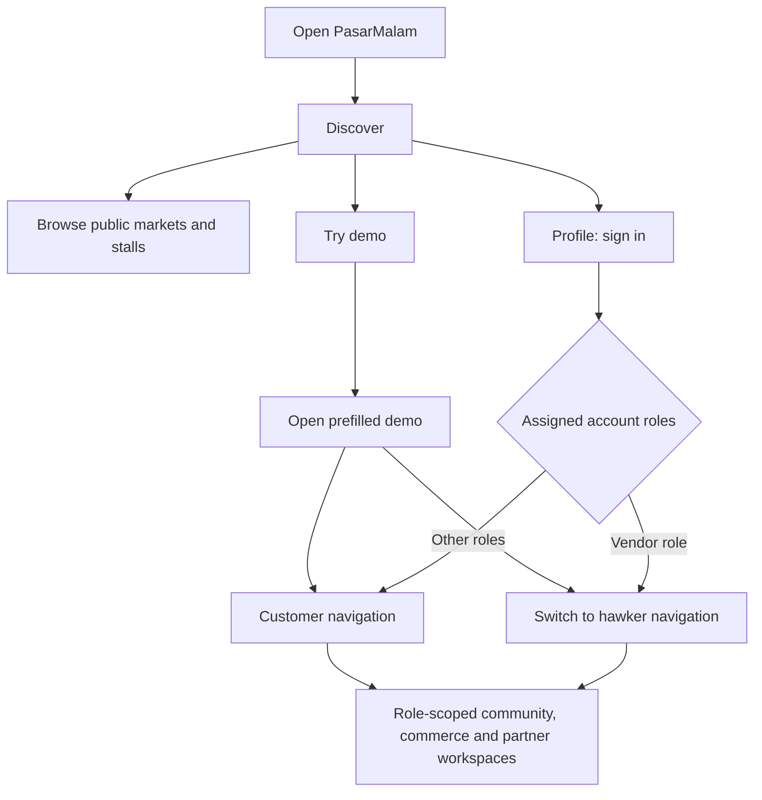
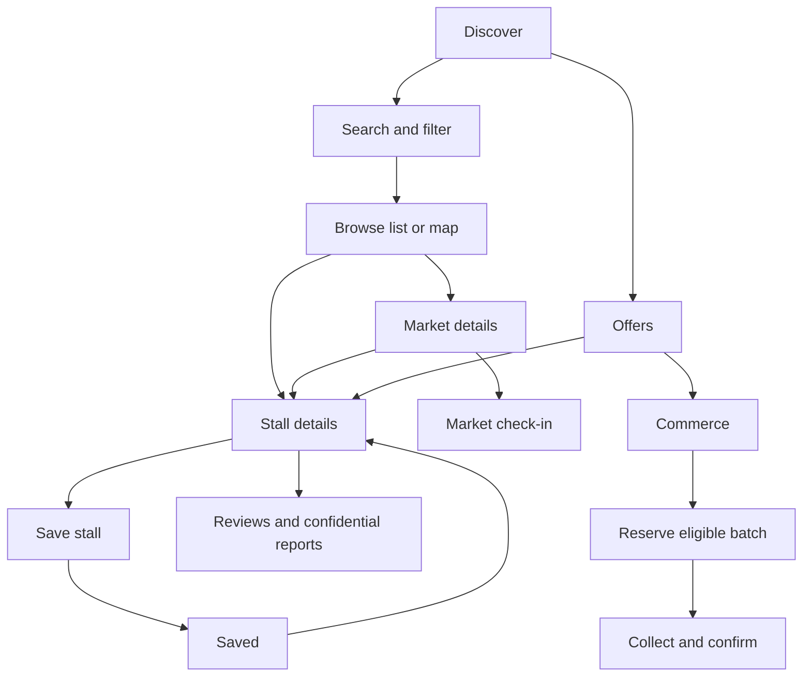
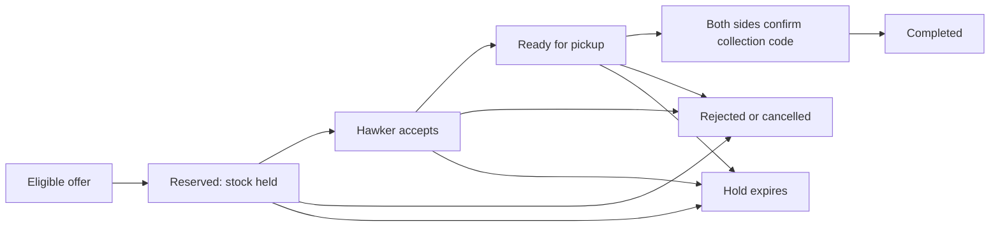
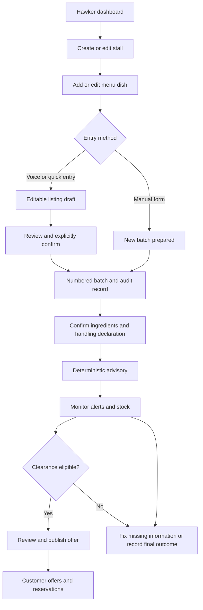

# PasarMalam App Flow

**Prepared:** 7 October 2026
**Scope:** Screens, navigation and workflows implemented in this repository.

PasarMalam connects shoppers, hawkers and market organisers around market discovery, food listings, batch tracking and surplus collection. Its central journey is:

**Discover → prepare → record → review → monitor → offer → reserve → collect.**

## 1. Entry and app modes

| Mode | Entry | Behaviour |
| --- | --- | --- |
| Real app | `/` → `/discover` | Uses the connected gateway. Public discovery is separate from account-based actions; availability depends on configured services. |
| Prefilled demo | Try demo → Open prefilled demo → `/demo/discover` | Fictional records stored on this device. No account required. Users can switch demo roles and personas. |
| Connected sandbox | `/sandbox/discover` | Acceptance workspace using a guarded disposable project and actual account permissions. |

Routes below are written without a mode prefix. For example, `/hawker/voice` becomes `/demo/hawker/voice` in the demo or `/sandbox/hawker/voice` in the sandbox.

### Account flow

1. Open **Profile** → account section.
2. If authentication is configured, sign in with an invited account using email and password.
3. The app reads assigned roles. An account with the `vendor` role receives hawker navigation; other accounts receive customer navigation.
4. Vendor screens require the vendor role. Connected admin controls require the admin role. Other workspaces enforce their own roles and ownership.
5. Invalid credentials, an expired session or missing configuration show an account message. Protected screens link back to Profile.
6. Signed-in users can sign out from Profile.

There is no self-service registration screen. Demo role switches change the fictional experience; they do not grant connected permissions.

## 2. Navigation and screen map

### Primary navigation

| User interface | Desktop navigation and mobile bottom navigation |
| --- | --- |
| Customer | Discover → Offers → Saved → Profile |
| Hawker | Dashboard → Stall → Batches → Promotions → Alerts |

Hawker workspace pages also link to **Voice & quick entry** and **Language & privacy**. Profile links to the additional workspaces.

### Routes

| Route | Screen / purpose | Main onward actions |
| --- | --- | --- |
| `/discover` | Search, filters, market list/map and stall cards | Market details, stall details |
| `/markets/:id` | Market schedule and its stalls | Check in, open a stall, return to discovery |
| `/stalls/:id` | Stall details, menu, active batches, offers and reviews | Save/unsave, location link, community page |
| `/offers` | Currently eligible clearance offers | Stall details; commerce reservations/history |
| `/saved` | Saved stalls | Stall details; Profile when sign-in is required |
| `/profile` | Account, language, privacy and nearby notification preferences | Additional workspaces; demo reset |
| `/hawker/dashboard` | Stall overview, menu, batches and advisory summary | Listing forms, voice entry, alerts |
| `/hawker/stall` | Stall and menu workspace | Create/edit stall, add/edit dish, customer listing |
| `/hawker/batches` | Numbered batch history and audit controls | New batch, stock actions, corrections, merge |
| `/hawker/voice` | Voice, transcript and manual quick entry | Review/confirm a listing; evaluation |
| `/hawker/promotions` | Freshness advisories and clearance | Confirm declaration, publish offer, record outcomes |
| `/hawker/alerts` | Same advisory and clearance screen as Promotions | Read reminders, inspect batches and clearance drafts |
| `/community` | Reviews, confidential reports and moderation | Persona/role workspace, replies, appeals, audit history |
| `/community/:id` | Community screen with the stall initially selected | Same actions as Community |
| `/commerce` | Reservations, order history, ads and commercial previews | Collection confirmation, receipts, campaigns, exports |
| `/partners` | Collaboration, authority, permit and collection workflows | Scoped decisions, timelines, public features, receipts |
| `/advanced` | Advanced demo previews; connected push setup entry | Scenario tabs, preference controls and linked workflows |
| `/presentation` | Demo studio | Reset/scenarios, guided workflow links, pilot/media views |
| `/evaluation` | Speech evaluation and paired timing tasks | Voice/typing task, measured-result report |
| `/admin/*` | Demo time/weather controls or guarded connected clock override | Advance scenario, return to alerts |

Unknown routes show an empty state. Advanced fictional previews and the presentation dataset are available only in the demo; their connected routes show an explanation and demo entry instead.

## 3. Customer journey

### Discover markets and food

1. Search for food, markets or stalls.
2. Filter by market, area, day/night market, food category, dietary status and promotions.
3. Sort by reviews, popularity or nearest. Distance controls require a manually selected area or device location.
4. Optionally choose **Use location**. If permission is denied, manual area selection remains available. Device location expires after two hours.
5. Toggle the market map, browse paginated results and open a market or stall.
6. Market details show scheduled opening information and stall cards. Eligible connected customers can check in.
7. Stall details show its declared status, menu ingredients, separate active batches, preparation/upload times, advisory deadlines, remaining stock, offers and published reviews.

Certified and hawker-declared halal statuses are presented separately. Sponsored placement is labelled and still follows applicable filters and offer eligibility.

### Save and revisit a stall

**Stall details → Save stall → Saved → Stall details.**

Connected saving requires an eligible signed-in customer; the screen links to Profile when necessary. Users can unsave a stall from its detail page. An empty saved list displays an explanation.

### Reserve and collect clearance food

The Offers page links to **Reserve clearance / order history** in Commerce. Offer cards open stall details; reservation happens in Commerce.

1. Select an eligible batch offer and number of bundles.
2. Choose pickup/pay at stall and estimated fulfilment time. Delivery and online payment are separately labelled future simulations.
3. Reserve within available stock and time limits. Each order covers one stall and one batch.
4. The hawker accepts or rejects the reservation. Accepted orders can be marked ready.
5. At pickup, the shopper and hawker each enter the collection code and explicitly confirm collection/payment.
6. Once both confirmations succeed, the order completes. History offers a demo CSV receipt and printable receipt.

Stock holds last at most ten minutes and stop at the earlier offer/fulfilment cutoff. Late confirmation cannot reopen an expired order. Future payment scenarios include success, failure, timeout and late callbacks; vendor refund and dispute actions appear where permitted. The current commerce experience simulates money and delivery.

## 4. Hawker journey

### Stall and menu setup

1. Choose an assigned stall or open **New stall**.
2. Enter name, market, category, specialty, price, lot, hours, map pin, open/closed state and halal declaration.
3. Save the stall.
4. Add a dish with name, price and ingredients; edit existing dishes when needed.
5. Use **View customer listing** to inspect the public stall page.

### Manual batch entry and stock management

1. Open **New batch prepared** and choose an existing dish.
2. Enter preparation time, optional quantity, storage/handling details and an optional supported image.
3. Save to create an independent numbered batch. A new batch needs the relevant declaration/advisory before clearance eligibility is established.
4. Inspect batch history and record sales, sold out, withdrawal or discard.
5. Open the audit trail to append an earlier preparation correction.
6. Where valid, restore withdrawn stock within its original window or merge compatible selected batches.

Original preparation/upload records remain in history. Corrections can shorten the window; merging retains the earliest time/deadline, closes source batches and requires policy reevaluation.

### Voice and quick entry

1. Choose a stall with an existing menu dish.
2. Use one of the available entry paths:
   - Load the speech model → permit microphone access → record → stop → transcribe.
   - Type or edit a transcript.
   - Enter fields directly with quick-entry chips, or load a labelled scripted sample.
3. Review the transcript. Where extraction uses Morpheus, explicitly consent to sharing the redacted transcript and menu names. Demo extraction also requires fictional-input acknowledgement.
4. Extract an editable draft and inspect its source, confidence indicators and flagged fields. Extraction failure can return a labelled quick-entry fallback.
5. Choose **New batch** or **Update menu only**. Confirm the dish, price, ingredients, quantity, unit, preparation time and ambient handling as applicable.
6. Explicitly confirm the listing. New-batch confirmation updates the dish and creates one batch together; menu-only confirmation creates no batch.
7. Return to the workspace or Alerts to review the saved result and declaration.

Audio is deleted after transcription, cancellation or failure. Unsupported audio or denied microphone access leaves text entry available. No voice draft publishes automatically.

### Advisory, reminders and clearance

1. Open **Promotions** or **Alerts**; both render the same centre.
2. Inspect current reminders, choose a batch and confirm/fix its ingredients, preparation acknowledgement and handling declaration.
3. Review the absolute deadline, remaining time, weather inputs and policy explanation.
4. For eligible stock with more than fifteen minutes remaining, choose percentage discount, fixed price, RM0 or a two-unit BOGO bundle.
5. Set stock units and explicitly choose **Confirm and publish offer**.
6. The offer appears in customer discovery/Offers/Commerce while eligibility remains valid.
7. Record discounted sales or discarded weight, or handle reservation collection in Commerce.

Clearance ends at least fifteen minutes before the batch deadline, or at market closing if earlier. Expired, unavailable or ineligible stock cannot be offered. Discounts and scenario clock changes never extend existing batch windows. The policy is a synthetic demonstration advisory, not food-safety certification.

## 5. Community trust and moderation

### Reviews

**Stall details → Reviews & confidential reports → verified customer review → pending moderation → publish or hide → public stall reviews.**

Customers maintain one review per stall; edits return it to pending. Verified customers can report a published review for moderator attention.

### Confidential reports, replies and appeals

1. A verified customer selects a stall, report category, incident time and description.
2. Attach permitted private evidence or demo placeholders, acknowledge confidentiality limits and submit.
3. The report enters a private queue. The reporter can submit follow-ups inside the app.
4. Restricted moderators review evidence, record independence groups and exclude duplicate/collusion indicators.
5. Organisers see redacted summaries. Hawkers see approved summaries and can reply or appeal.
6. A moderator can approve a neutral public flag only after the required review threshold and reply opportunity: three independent verified reviewed reports within fourteen days, distinct groups and forty-eight hours to reply.
7. Approved replies, flag removal and other moderation decisions enter the history. Flags are never automatic.

The public and hawker do not receive reporter identity, raw reports or evidence. Reports are limited to three new reports per Malaysia calendar day; the same open stall/incident updates the existing report.

Moderator queues also support stall publication, reviewed dietary declarations and market schedule changes. Reviewed referrals continue through Partners using an explicitly approved redacted summary and consent.

## 6. Commerce and advertising workspaces

| Role | Flow |
| --- | --- |
| Shopper | Eligible offer → reserve → order history → collection confirmation → receipt |
| Hawker | Accept/reject → ready → confirm collection/payment → permitted refund/dispute handling; inspect assigned inventory/revenue |
| Advertiser / hawker | Complete applicable onboarding → choose stall/market/category → creative description, radius, schedule and budget → submit campaign → admin review → labelled placement → inspect simulated impressions/clicks/spend → pause/resume |
| Admin | Approve/reject/pause campaigns; set the hypothetical commission rate for new reservations |
| Courier | Assigned future delivery job → accepted → picked up → arrived, or failed/cancelled |
| Organiser | Market-scoped commerce/activity summaries and suppressed aggregates |

Free/premium previews expose subscription changes and applicable CSV exports. Commission applies to completed, undisputed clearance; reservation alone, cancellation, expiry and no-show do not generate commission. Refunds reverse the related commission. Payments, subscriptions, ads and courier events are internal simulations.

## 7. Partner, authority and surplus flows

| Workflow | Main path | Alternate outcomes |
| --- | --- | --- |
| Media/supplier collaboration | Hawker request → submit → assigned editor/company review → approve → editor publishes eligible feature | Changes requested, rejection, pending or timeout/retry |
| Editorial trail | Editor selects 2–5 distinct eligible stalls → creates trail → publishes → public trail links to stalls | Invalid or ineligible stops rejected |
| Authority case | Reviewed report → moderator previews redacted fields and consents → simulated case submitted → assigned officer acknowledges → schedules → inspects → corrective action → follow-up → resolves | Invalid gates/ownership rejected; pending or timeout/retry |
| Permit / dietary evidence | Hawker application → submit → assigned council review → approve/reject | Expiry; permit renewal after expiry/rejection |
| Surplus pickup | Hawker selects batch, organisation, route and portions → request → assigned collector accepts → schedules → confirmed collection → receipt/totals | Rejection, missed pickup, hawker cancellation or eligibility failure |

Donation for consumption requires an eligible batch and advisory buffer. Compost and BSF are separate non-consumption routes and can handle stock that is ineligible for consumption. A valid confirmed pickup consumes stock; merely requesting pickup does not.

Collection receipts keep estimated and weighed amounts separate. Consumption, compost and BSF totals stay distinct. Published editorial features remain separate from sponsored advertisements. These workflows use fictional organisations and do not send official referrals, issue legal permits or dispatch real collections.

## 8. Profile, advanced previews and demo tools

### Profile

**Profile → account / English or Bahasa Melayu / privacy choices / read aloud / nearby clearance preferences / additional workspaces.**

Nearby preference flow: select coarse market area → opt in → eligible notification processing. Opt out revokes consent and cancels pending deliveries. Demo delivery is simulated; actual device push requires configured connected setup and device consent.

### Advanced previews

From Profile → **Notifications, forecast & advanced previews**:

- **Notifications:** choose fictional recipient/channel → set preferences → queue event → dispatch → inspect inbox → simulate failure/retry or opt out.
- **Sensors/research:** inspect synthetic storage timelines, missing readings, excursions and weather/ingredient inputs → follow the Alerts link for operational batch review.
- **AI:** choose a scripted language/scenario → edit and acknowledge preview draft; previews do not publish operational listings.
- **Native:** select platform/screen and simulated permission state → follow real demo links to discovery, offers or hawker dashboard.
- **Dashboards/forecast:** filter synthetic histories → inspect aggregate metrics, sample sufficiency, rain assumptions and chronological evaluation.

### Presentation studio

**Profile → Full demo studio & pilot → Reset complete local demo → choose scenario → open linked workflow.**

The studio includes guided links, fictional pilot/business summaries, described image slots, synthetic training clips, draft share/QR assets and searchable seed histories. Reset restores local fictional state and its frozen scenario clock. The header **Exit demo** returns to real-app discovery.

### Evaluation

**Voice & quick entry → Evaluation → choose clip, anonymous pair ID, device/network, consent and task order → start voice or typing task → confirm listing → return to evaluation → inspect valid paired timings.**

Measured-results JSON can be imported to calculate a report. Invalid input produces an error without a score. Scripted samples and generated histories do not establish speech accuracy; human speech measurements remain pending.

## 9. Loading, errors and recovery

| Situation | User-visible response / next step |
| --- | --- |
| Data loading | Loading state while the screen fetches its workspace |
| Service unavailable | Error and retry; connected discovery also offers demo entry |
| No matches, stock, offers or saved stalls | Empty state; relax filters, add records or choose another workflow |
| Insufficient role or ownership | Access denied/rejected action; Profile or assigned workspace as appropriate |
| Uncertain save outcome | Where supported, retry the same pending command/request key before another change |
| Invalid listing or upload | Validation error; correct fields or choose a supported file |
| Unsent manual listing | Text draft retained in the tab; files must be selected again after reload |
| Offline | Banner explains connected actions are unavailable; connected writes are not queued |
| App update available | Finish/save current work → Update app → reload |
| Expired offer, hold or batch | Recheck eligibility; retain history without reopening the original window |

## 10. Implementation references

- [App routes and navigation](apps/web/src/app/App.tsx)
- [Mode boundaries](apps/web/src/app/config.ts) and [router prefixes](apps/web/src/main.tsx)
- [Customer discovery screens](apps/web/src/discovery/DiscoveryPage.tsx)
- [Hawker workspace](apps/web/src/vendor/VendorPage.tsx), [voice entry](apps/web/src/voice/VoicePage.tsx) and [advisory centre](apps/web/src/freshness/FreshPage.tsx)
- [Community](apps/web/src/community/CommunityPage.tsx), [Commerce](apps/web/src/commerce/CommercePage.tsx) and [Partners](apps/web/src/partners/PartnerPage.tsx)
- [Advanced previews](apps/web/src/advanced/AdvancedPage.tsx), [presentation studio](apps/web/src/presentation/PresentationPage.tsx) and [evaluation](apps/web/src/voice/EvaluationPage.tsx)
- [Demo walkthrough and implementation boundaries](docs/demo-guide.md)

This flow documents the local prototype. The repository README records deployment on hold and connected-service/device acceptance still pending; route availability does not imply a live production service.
