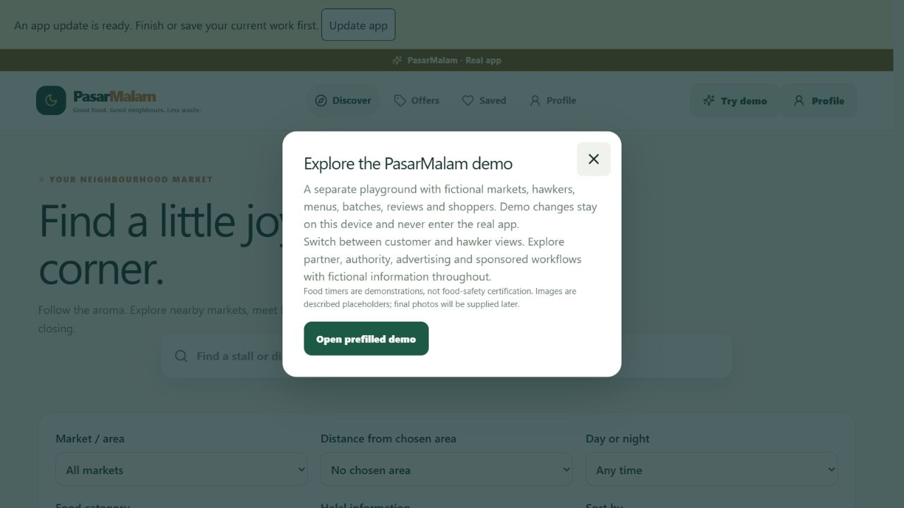
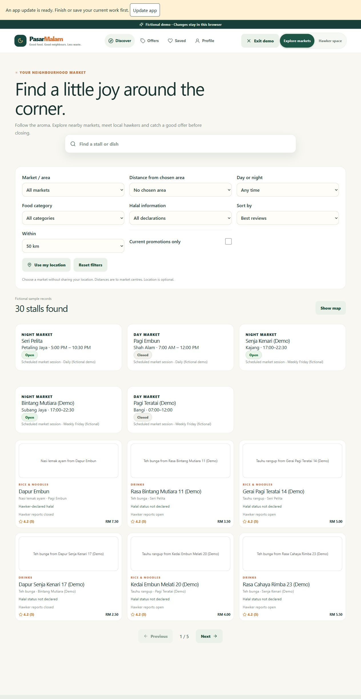
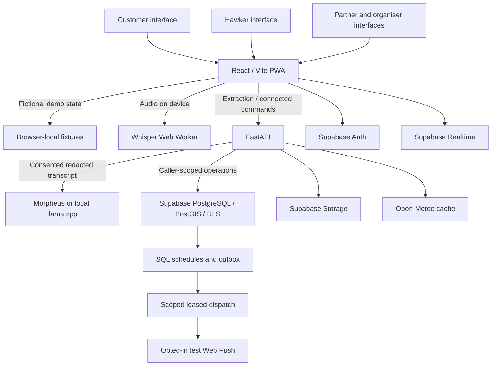

# PasarMalam — Community Markets, Voice Listings & Surplus Food

<div align="center">
  <h3>Good food. Good neighbours. Less waste.</h3>
  <p>A community market app for Malaysia's hawkers, shoppers and market organisers.</p>
  <p>
    <a href="#try-the-demo"><strong>Explore the Demo</strong></a> ·
    <a href="#the-problem-and-our-approach"><strong>Problem & Approach</strong></a> ·
    <a href="#ai-and-agent-design"><strong>AI & Agent Design</strong></a> ·
    <a href="#run-locally"><strong>Run Locally</strong></a> ·
    <a href="#system-architecture"><strong>Architecture</strong></a>
  </p>
  <p><strong>React · TypeScript · Vite · FastAPI · Supabase · Morpheus</strong></p>
</div>

**Current status — 5 October 2026:** locally built prototype with a separate prefilled demo. Deployment is on hold. Vercel is the planned frontend host and Railway the planned backend host; neither is live. Connected Supabase, human speech evaluation and full device acceptance remain unfinished.

## Overview

PasarMalam helps shoppers discover day and night markets, find stalls and promotions, and understand how food batches were prepared. Hawkers get a separate workspace for menus, numbered batches, stock and clearance offers, including voice-assisted entry in Bahasa Melayu, English and Manglish.

The core workflow is **prepare → record → review → monitor → offer → collect**. A hawker confirms a batch's details, receives a deterministic advisory, and can offer eligible surplus before the window closes. Expired batches become ineligible for clearance; a discount never extends the deadline.

The demo includes the broader product vision: sponsored listings, advertisements, reservations, organiser dashboards, company collaborations, authority referrals and surplus collection. These business workflows use fictional records and internal simulations. They do not contact real companies, agencies, couriers or payment services.

## Table of Contents

- [The Problem and Our Approach](#the-problem-and-our-approach)
- [Why PasarMalam](#why-pasarmalam)
- [Core Features](#core-features)
- [Try the Demo](#try-the-demo)
- [Signature Workflows](#signature-workflows)
- [AI and Agent Design](#ai-and-agent-design)
- [System Architecture](#system-architecture)
- [Tech Stack](#tech-stack)
- [Run Locally](#run-locally)
- [Environment Variables](#environment-variables)
- [API Reference](#api-reference)
- [Privacy and Community Trust](#privacy-and-community-trust)
- [Business Model and Pilot](#business-model-and-pilot)
- [Verification and Project Status](#verification-and-project-status)
- [Deployment and Remaining Work](#deployment-and-remaining-work)
- [Troubleshooting](#troubleshooting)
- [Project Structure](#project-structure)
- [Documentation](#documentation)

## The Problem and Our Approach

Informal stalls often operate without a point-of-sale system or structured inventory. Shoppers need current market information, while hawkers need a quick way to record preparation times and manage unsold food near closing.

| Problem | PasarMalam's approach |
| --- | --- |
| Locations, schedules and menus are scattered | Map/list discovery, day/night schedules and current stall information |
| Inventory entry competes with serving customers | Voice-to-draft extraction, editable fields and quick-entry chips |
| Preparation times disappear when new food is cooked | Independent numbered batches with preparation/upload times and audit history |
| Surplus remains near closing | Reminders, hawker-confirmed clearance and pay-at-stall reservations |
| Discounts could encourage selling expired food | Fixed deadlines, eligibility checks and expired-offer delisting |
| Hygiene complaints can expose reporters or unfairly harm stalls | Verified accounts, private early reports, moderation and hawker replies |
| Organisers lack operational visibility | Scoped dashboards, permits, reported outcomes and surplus collection |

Food-window rules are **synthetic advisory policies**, not scientific certification. A real-food pilot needs expert policy and handling review.

## Why PasarMalam

- **Built for informal stalls:** separate hawker/customer interfaces and voice/manual entry without requiring a POS.
- **Batch-level accountability:** a new preparation creates a new batch; editing a listing does not make old stock fresh again.
- **Human-controlled AI:** extraction creates a draft with transcript evidence, confidence indicators and correction controls.
- **Rules govern eligibility:** food deadlines, stock and clearance checks stay outside the LLM.
- **Transparent discovery:** declared and certified halal statuses are distinct; sponsorship is labelled and respects dietary and eligibility filters.
- **A complete fictional showcase:** explore the business and partner vision locally before external integrations are activated.

Reduced listing effort and better surplus coordination are intended benefits. Time savings, waste reduction and real-world food outcomes have **not yet been measured**.

## Core Features

| Area | Features | Current boundary |
| --- | --- | --- |
| Discovery | Markets, map pins, schedules, categories, proximity, popularity/reviews and promotions | Local fixtures; connected Realtime acceptance pending |
| Hawker workspace | Stall/menu editing, numbered batches, stock actions, corrections and audit trails | Fixture workflows; live database/media checks pending |
| Voice listings | Local transcription, BM/English/Manglish extraction, evidence and confirmation | Morpheus text checks pass; human speech benchmark pending |
| Freshness/clearance | Ingredient/weather caps, conservative uncertainty, reminders and expiry | Demonstration policy; no food-safety badge |
| Community | Reviews, confidential reports, moderation, replies and appeals | Fictional verified personas; connected privacy checks pending |
| Commerce | Reservations, collection codes, pay-at-stall, commissions, receipts and delivery | No real payment, courier or subscription transaction |
| Advertising | Campaigns, approval, budgets and labelled sponsored placement | Internal simulation; no ad-network integration |
| Partners/authorities | Collaborations, editorial trails, reviewed referrals, officer case steps and permits | Fictional organisations; no official submission |
| Surplus routes | Donation, compost and BSF pickups with separate receipts/weights | Synthetic transfers; consumption/non-consumption totals stay separate |
| Advanced previews | Notifications, telemetry, research, scripted AI and forecasts | Labelled simulations; genuine push needs a consenting device |
| Presentation | Scenario reset, pilot/business views, assets and guided scripts | Browser-local fixtures and generated histories |
| PWA | Manifest, public-shell caching, update control and offline explanation | Local update verified; physical-device acceptance pending |

## Try the Demo

Start the frontend using [Run Locally](#run-locally), then open [the local demo](http://127.0.0.1:5174/demo/discover). This link works only on the computer running the app; there is no hosted demo yet.

From the real-app screen, click **Try demo → Open prefilled demo**. No account or Supabase connection is needed for the fictional playground. Optional Morpheus extraction requires the local API, a provider key and explicit transcript-sharing consent.

| Route | Purpose |
| --- | --- |
| `/demo/discover` | Customer discovery with prefilled markets/stalls |
| `/demo/hawker/voice` | Voice draft, editable fields and chips |
| `/demo/community` | Reviews, reporting and moderation personas |
| `/demo/commerce` | Reservations, advertisements and commercial scenarios |
| `/demo/partners` | Company, authority, organiser and collection workflows |
| `/demo/advanced` | Notification, telemetry, analytics and forecast previews |
| `/demo/presentation` | Full demo studio, reset, pilot and assets |
| `/demo/evaluation` | Evaluation workflow with unmeasured results identified |

### Separate workspaces

| Mode | Data and access |
| --- | --- |
| `/demo/*` | Fictional browser-local records, presentation personas and reset; no Supabase account writes |
| `/sandbox/*` | Connected acceptance requiring a guarded disposable Supabase project and actual caller permissions |
| Root app routes | Separate real-app entry; no demo fixtures, and disposable-demo API rejected for production use |

The fixture catalog contains **10 markets, 30 stalls/owners, 50 shoppers, 90 foods, 150 batches and 150 reviews**, plus business histories. These are fictional fixture counts, not provisioned Supabase counts.

All photo slots are **white boxes with centred descriptions**. Final user-supplied images are pending; 100 individually described asset slots are reserved. Demo times are frozen scenario times, not current market conditions.

### Five-minute tour

1. Open `/demo/presentation` and select **Reset complete local demo**.
2. Explore discovery; filter a market, category and halal declaration, then inspect a stall's menu and batches.
3. Choose **fresh**, open the hawker workspace, enter a listing through chips or voice/text, review and confirm.
4. Choose **reminder**; inspect the original deadline and publish an eligible clearance after hawker confirmation.
5. Inspect customer offers, then **ending** to demonstrate expiry. Explore moderated reports and labelled sponsorship.

The [demo guide](docs/demo-guide.md) includes the longer commerce, authority, donation and advanced walkthroughs.

<details>
<summary>Preview: separate demo entry and described image boxes</summary>





These show the local fictional app, not a deployed service or supplied food photography.

</details>

## Signature Workflows

### Speak, review, confirm

```text
Microphone → local Whisper transcription → editable transcript
→ external-sharing consent if Morpheus is selected
→ schema/evidence-checked draft → hawker correction → confirmation
```

“Satay ayam dua puluh batang RM 6.00 … siap pukul 5 petang” can become a draft for the selected stall's Chicken satay: 20 sticks, 600 sen and a resolved preparation time. Missing or ambiguous fields require review. Audio is discarded after transcription, cancellation or failure; the model cannot publish the listing.

### Closing-time clearance

```text
Active batch → deterministic advisory → reminder/clearance draft
→ hawker confirms → eligible offer → reservation/collection
→ expiry or stock exhaustion ends eligibility
```

Connected implementation includes SQL state, outbox events and leased dispatch; live execution remains pending. The local demo demonstrates these transitions with fictional state.

### Private report to reviewed referral

```text
Verified reporter → confidential report → organiser/moderator review
→ independence/reply checks → explicit flag or referral decision
→ assigned fictional officer workflow
```

Reporter identity and original private evidence are excluded from public projections. This never files a real complaint.

## AI and Agent Design

### Deterministic advisory engine

The engine takes the minimum of versioned caps for ingredient risk, temperature, humidity and uncertainty, anchored to the original preparation time. Missing information can shorten or block a window. Merges preserve the earliest deadline; corrections cannot extend it.

Open-Meteo supplies weather in the connected implementation. Fixtures use labelled weather values. Model wording and discounts cannot override eligibility.

### Evidence and human control

FastAPI supports consented **Morpheus `qwen35-9b`** and optional authenticated loopback **Qwen/llama.cpp** extraction. Pydantic validates responses; transcript evidence supports extracted fields. Confidence is an **uncalibrated heuristic**, not a probability or safety score.

Menus belong to the selected stall. External extraction sends a redacted transcript and menu/context after consent; audio stays on-device. Chips/manual entry remain available when speech or extraction fails.

### Bounded calls and fallbacks

The cloud adapter enforces an approved endpoint/model, timeout, at most 800 completion tokens, bounded response size and two concurrent requests. It does not automatically retry or switch paid providers. Invalid output, quota errors and unavailable service return a manual-entry path.

Qwen reasoning is disabled through a gateway compatibility option verified in live checks; otherwise it exhausted the response budget before returning a listing. Output validation remains mandatory if provider behaviour changes.

Free Morpheus allowance is **not established**. No credits or plan were purchased during implementation. Local-model extraction and typing avoid cloud inference charges.

## System Architecture



This diagram shows implemented service boundaries, not completed live acceptance. Browser-local fixtures work independently of Supabase. Connected jobs, Storage, Realtime and device push still need runtime verification. Company, authority, advertisement, payment and delivery integrations remain internal mocks.

## Tech Stack

| Layer | Tools |
| --- | --- |
| Frontend | React 19, TypeScript 5.9, Vite 7, React Router |
| UI/forms/languages | Tailwind CSS 4, Radix Dialog, Lucide, React Hook Form, Zod, i18next |
| Data/maps | TanStack Query, Supabase JS, Leaflet, configurable OSM tiles |
| Backend | Python 3.12, FastAPI, Pydantic, Uvicorn, HTTPX |
| Database/auth/media | Supabase PostgreSQL, PostGIS, RLS, Auth, Storage, Realtime |
| Speech/AI | Transformers.js, Whisper-tiny ONNX, Morpheus Qwen, optional llama.cpp |
| Weather/jobs/push | Open-Meteo, pg_cron/pg_net, SQL outbox, pywebpush/VAPID |
| Tooling | npm/uv lockfiles, TypeScript, ESLint, Ruff, Vitest, pytest |
| Planned hosting | Vercel frontend, Railway backend; deployment deferred |

Resolved versions are in [package-lock.json](package-lock.json), [web package.json](apps/web/package.json) and [uv.lock](apps/api/uv.lock).

## Run Locally

### 1. Install dependencies

Requirements: **Node.js 24, npm 11, Python 3.12 and uv**. `.nvmrc` pins Node. Run commands from the repository root. The private repository requires GitHub access.

```powershell
git clone https://github.com/TEE123754/PasarMalam.git
cd PasarMalam
npm ci --cache .npm-cache
uv sync --project apps/api --frozen
```

### 2. Start the standalone demo

```powershell
npm run dev -- --port 5174
```

Open **http://127.0.0.1:5174/demo/discover** or **http://127.0.0.1:5174/demo/presentation**. No database key is needed for browser-local workflows. Without a model/API, use scripted samples or manual chips.

### 3. Add optional API extraction and connected services

For a fresh clone, copy templates once. **Do not overwrite existing configured environment files.**

```powershell
Copy-Item .env.example apps/web/.env.local
Copy-Item apps/api/.env.example apps/api/.env
```

Set `VITE_API_BASE_URL=http://127.0.0.1:8010` in the web file. Include `http://127.0.0.1:5174` in backend `ALLOWED_ORIGINS`. Configure the optional services you intend to exercise using the settings below.

In a second terminal:

```powershell
uv run --project apps/api uvicorn app.main:app --app-dir apps/api --host 127.0.0.1 --port 8010 --env-file apps/api/.env
```

Check **http://127.0.0.1:8010/health** and **http://127.0.0.1:8010/docs**. Health confirms the API process, not database/job readiness. Restart the frontend after changing Vite environment variables; rebuild if using a production preview.

### 4. Preview the production PWA

Service-worker registration runs in production builds, not development mode.

```powershell
npm run build
npm run preview -w @pasarmalam/web -- --port 5174
```

Use different ports when running development and preview together. The current session uses web **5174** and API **8010** because 5173/8000 were occupied.

Connected `/sandbox/*` needs guarded migrations, assigned accounts/memberships and service setup. Follow [Phase 2 setup](docs/phase2-setup.md) and [user actions](docs/USER_ACTIONS.md); never seed an arbitrary production database.

## Environment Variables

Templates are committed; actual `.env` files are ignored and excluded from the GitHub backup. Never put private credentials in `VITE_` variables.

| Setting | Location | Purpose |
| --- | --- | --- |
| `VITE_API_BASE_URL` | Web `.env.local` | Local API URL, currently port 8010 |
| `VITE_SUPABASE_URL`, `VITE_SUPABASE_PUBLISHABLE_KEY` | Web `.env.local` | Public connected Auth/data configuration |
| `VITE_MAP_TILE_URL` | Web `.env.local` | Map tile provider |
| `APP_ENV`, `ALLOWED_ORIGINS` | API `.env` | Demo environment and exact frontend origins |
| `SUPABASE_URL`, `SUPABASE_PUBLISHABLE_KEY` | API `.env` | Matching Supabase project |
| `EXTRACTION_PROVIDER` | API `.env` | `morpheus` or `local` |
| `MORPHEUS_API_KEY`, `MORPHEUS_BASE_URL`, `MORPHEUS_MODEL` | API `.env` | Backend extraction; model `qwen35-9b`, base `https://api.mor.org/api/v1` |
| `LOCAL_LLM_URL`, `LOCAL_LLM_MODEL` | API `.env` | Optional authenticated loopback model |
| `DATABASE_URL`, `SUPABASE_SECRET_KEY` | Private operator environment | Guarded migrations/provisioning |
| `DEMO_PROJECT_REF`, `DEMO_DATABASE_ID`, `DEMO_SEED_PASSWORD` | Private operator environment | Disposable-target guard and fictional accounts |
| Media, agent and VAPID secrets | Private backend/operator environment | Scoped media/jobs and opted-in push |

No commercial integration key is needed for business fixtures. Full details are in [the API template](apps/api/.env.example) and [USER_ACTIONS.md](docs/USER_ACTIONS.md).

## API Reference

The [OpenAPI contract](contracts/openapi.json) contains endpoint schemas. Connected commands require actual roles and ownership; switching a demo persona does not grant real permissions.

| Endpoint/group | Purpose |
| --- | --- |
| `GET /health`, `GET /api/v1/config` | Process health and public configuration |
| `/api/v1/discovery`, `/api/v1/discovery/nearby` | Discovery and geographic queries |
| `/api/v1/me`, favourites/check-ins | Caller identity and saved activity |
| `/api/v1/vendor/workspace`, `/api/v1/vendor/command` | Owned stall/menu/batch operations |
| `/api/v1/freshness/*` | Weather, advisories, confirmation, publishing and outcomes |
| `GET /api/v1/voice/config` | Provider mode and external-consent requirement |
| `POST /api/v1/voice/demo-extract` | Rate-limited, explicitly fictional demo extraction |
| `POST /api/v1/voice/extract`, `/api/v1/voice/confirm` | Authenticated draft extraction and confirmation |
| `/api/v1/community/*` | Moderation and private evidence |
| `/api/v1/commerce/*`, `/api/v1/partners/*` | Scoped simulated business/partner records |
| `/api/v1/push/*`, `/api/v1/agent/dispatch` | Test subscriptions and scoped dispatch |

## Privacy and Community Trust

- **No safety badge:** show an advisory and audit trail; never describe synthetic policy as certification.
- **Halal transparency:** declared, certified-evidence and undeclared statuses stay distinct. Never infer religion or ethnicity from stall names.
- **Private early reports:** verified-account/rate-limit controls, independence thresholds, moderation and a hawker reply opportunity govern public flags.
- **Optional location/push:** use coarse opt-in areas and separate device-notification consent.
- **Audio minimisation:** discard device audio after processing. Connected redacted-transcript retention/cleanup still needs live verification.
- **Caller isolation:** RLS and scoped roles/projections are implemented; skipped live checks are not proof of enforcement.
- **Offline boundaries:** public shell only; no private API/media caching or map prefetch. Connected writes are not silently queued offline.
- **Real-user review:** Malaysia's PDPA, retention, provider handling, moderation and food policy require review before a pilot. Implementation does not establish legal compliance.

See [the privacy data map](docs/privacy-data-map.md) for boundaries and retention fields.

## Business Model and Pilot

Proposed revenue combines labelled advertising/sponsorship, a small commission on completed clearance reservations, organiser/council dashboard subscriptions and premium demand forecasts. Basic access stays free in the product plan. Current charges and commissions are hypothetical demo records.

The proposed pilot is **one market, 10 stalls, four weeks**. Seed the hawker side with the organiser, then reach shoppers through reviewed WhatsApp/Facebook/TikTok community outreach. Nothing is posted automatically.

Measure **net RM recovered per participating stall-night** and **explicitly weighed kg diverted to human consumption**. Reservations and no-shows are not completed sales; compost/BSF totals stay separate. The [pilot plan](docs/pilot-plan.md) defines denominators, refunds, costs and evidence. No real pilot results are claimed.

## Verification and Project Status

| Check | Latest recorded result |
| --- | --- |
| Local regression batch | **186 frontend passes; 149 API passes; 33 database-dependent skips** |
| Static/build checks | ESLint, TypeScript, production build and Ruff passed |
| Affected model/PWA repairs | 28 voice/provider API checks and three service-worker checks passed |
| Real Morpheus text smoke | Three fictional English/BM/Manglish samples returned expected fields without flags |
| Browser | Consent, extraction, review/confirmation, stall-specific menus, demo separation and PWA update verified |
| Responsive preview | Final viewport/document widths both 375 px; no horizontal overflow observed |
| Secret scans | Configured private values excluded from frontend output and upload candidates |
| Human/device results | Pending; no WER, calibrated accuracy or measured listing-time improvement |

These checkpoint results do not mean every connected feature is accepted. See [local readiness](docs/local-readiness-acceptance.md) and [phase status](docs/phase-status.md).

### Development and testing

**Finish a phase/build batch, then run its gate once.** Group repairs and rerun affected checks; avoid watch-mode loops and full tests after each edit.

```powershell
npm run phase11:check
node scripts/check-repo-secrets.cjs
```

Live phase commands require the configured disposable project and explicit gate settings. Skips are not passes. Documentation-only edits do not require a build or full test run.

## Deployment and Remaining Work

| Service | Current position |
| --- | --- |
| Frontend/API | Localhost only |
| GitHub | Private source backup, not deployment |
| Supabase | At last check: Auth HTTPS reachable, direct DB unreachable, markets REST 404 |
| Morpheus | Configured privately; fictional text extraction exercised |
| Vercel/Railway | Planned final Phase 12; on hold |

Remaining work includes reachable guarded database setup/migrations; connected permission, Realtime, Storage, job, stock-race and genuine push acceptance; complete Phase 11 history/reset provisioning; human recordings/timing; physical-device/offline/install/export checks; and user images.

The core seed scaffold is **unexecuted** and does not yet implement all connected commerce/partner history or reset-to-today. Fixture counts are not database counts. Large speech/WASM assets also need low-memory phone testing.

Deployment begins only after a later instruction and readiness review. Account allowances/commercial eligibility must be checked then; free always-on hosting is not guaranteed. [Remaining jobs](docs/REMAINING_JOBS.md) separates local work from deployment; [the implementation plan](IMPLEMENTATION_PLAN.md) tracks the phase checklists.

## Troubleshooting

| Symptom | Check or next step |
| --- | --- |
| API unavailable | Health, matching API base, exact CORS origin and frontend restart/rebuild after settings changes |
| Port occupied | Use 5174/8010 and match configuration; leave unrelated processes alone |
| Supabase direct DB fails | Use a reachable Session pooler when IPv6 connectivity is unavailable; API keys cannot apply SQL migrations |
| No connected markets | Check migrations, guarded seed and permissions; `/demo/*` is independently prefilled |
| Extraction fails or hits quota | Check provider configuration/consent; use chips instead of repeated requests |
| Microphone denied or slow | Use text/chips; cross-device microphone needs a supported secure origin |
| Clearance refused | Correct missing preparation/handling information; never extend a deadline to bypass eligibility |
| Old demo changes appear | Reset in the studio; catalog regeneration does not overwrite an existing session |
| Update banner appears | Save current work, then choose **Update app** |
| Images are blank | Expected placeholders until final images arrive |

## Project Structure

```text
PasarMalam/
├── apps/web/                 React screens, fixtures, speech worker and PWA
├── apps/api/                 FastAPI routes, adapters and tests
├── contracts/                OpenAPI, policy, catalog and evaluation specs
├── supabase/migrations/      Ordered schema, RLS and transactional/job functions
├── scripts/                  Guarded setup, seeding, live gates and secret scans
├── docs/                     Acceptance evidence, guides, pilot and user actions
├── PRD.md                    Product requirements
├── IMPLEMENTATION_PLAN.md    Phase scope and checklists
└── IMAGE_GENERATION_PROMPTS.md  Optional one-prompt/one-image references
```

## Documentation

| Document | Purpose |
| --- | --- |
| [PRD](PRD.md) | Product, ethics, business requirements and boundaries |
| [Implementation plan](IMPLEMENTATION_PLAN.md) | Phase scope, stack, gates and remaining tasks |
| [Local readiness](docs/local-readiness-acceptance.md) | Checks, blockers and launch/recovery instructions |
| [Remaining jobs](docs/REMAINING_JOBS.md) | Local acceptance separated from deployment |
| [User actions](docs/USER_ACTIONS.md) | Supabase/keys, devices and later assets |
| [Demo guide](docs/demo-guide.md) | Core/full-vision scripts, reset and provenance |
| [Feature coverage](docs/feature-coverage.md) | Requirements mapped to screens and acceptance |
| [Phase status](docs/phase-status.md) | Historical checkpoints |
| [Pilot plan](docs/pilot-plan.md) | Four-week proposal and measurement definitions |
| [Evaluation report](docs/evaluation-report.md) | Speech evaluation status and limitations |
| [Tech references](TECH_REFERENCES.md) | Related repositories/models and source evidence |
| [Image prompts](IMAGE_GENERATION_PROMPTS.md) / [asset manifest](docs/asset-manifest.json) | Reserved descriptions and later image workflow |
