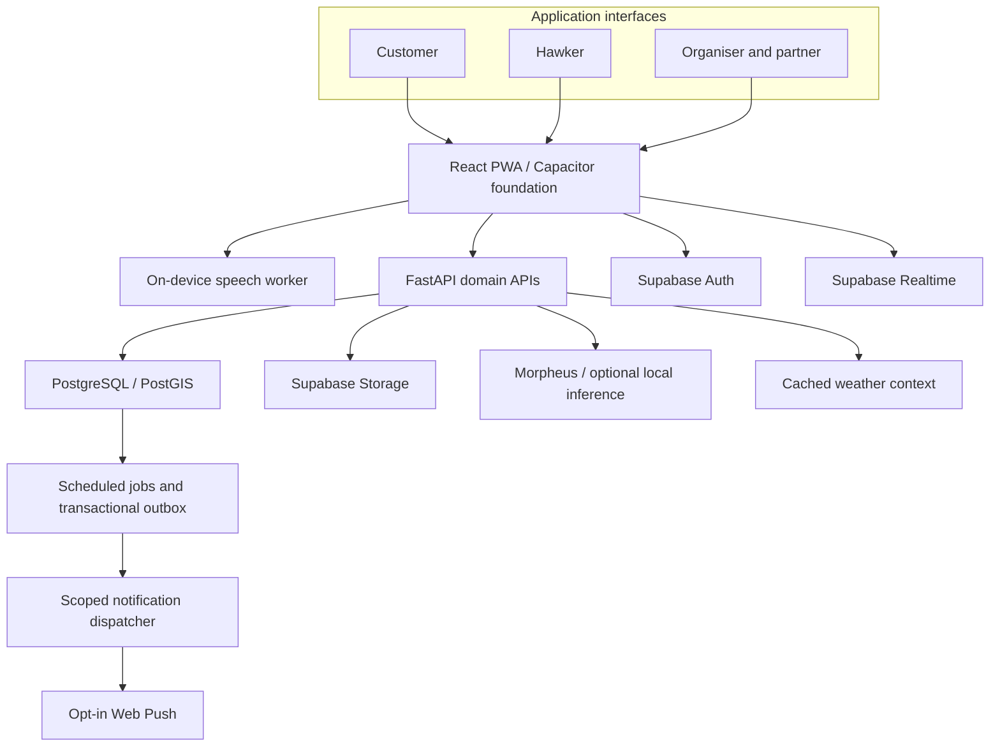

# PasarMalam

<div align="center">
  <h3>Good food. Good neighbours. Less waste.</h3>
  <p>A Malaysian community market platform connecting hawkers, customers and market organisers.</p>
  <p>
    <a href="#product"><strong>Product</strong></a> ·
    <a href="#whats-new"><strong>What's new</strong></a> ·
    <a href="#business-model"><strong>Business</strong></a> ·
    <a href="#technology"><strong>Technology</strong></a> ·
    <a href="#trust-and-inclusion"><strong>Trust</strong></a>
  </p>
  <p><strong>React · TypeScript · FastAPI · Supabase · Morpheus · PWA</strong></p>
</div>

PasarMalam brings Malaysia's pasar malam, pasar pagi and community food markets into one place. Customers discover stalls and affordable food nearby. Hawkers record what they cook, manage each batch and offer eligible surplus before closing. Organisers gain visibility into market activity, community concerns and food recovery.

The product combines **local discovery, voice-assisted inventory, preparation transparency and surplus coordination**, with separate interfaces for customers and hawkers. Its focus is the informal stall: a business that needs useful digital tools without a point-of-sale system or lengthy data entry.

## The opportunity

A market stall's information changes throughout the day: a new batch arrives, portions sell out, rain changes demand and closing time approaches. A static menu cannot capture that activity. PasarMalam treats the market, stall and individual food batch as connected records, so discovery and surplus offers reflect the food being sold.

| Business problem | Product value |
| --- | --- |
| Stall locations, operating schedules and menus are scattered | One map and searchable catalogue for day and night markets |
| Serving customers leaves little time for inventory entry | Voice-assisted listings and quick-entry controls |
| Customers cannot see when a displayed portion was prepared | Numbered batches, preparation timestamps, photos and advisory countdowns |
| Unsold portions lose value near closing | Timely clearance suggestions, reservations and collection records |
| Public complaints can expose reporters or unfairly damage stalls | Private early reporting, moderation and a hawker right of reply |
| Organisers lack a shared picture of market activity | Aggregated operational, hygiene and food-recovery insights |

## Who it serves

| Audience | Value proposition |
| --- | --- |
| **Customers** | Find local favourites, compare prices, understand preparation times, save stalls, reserve offers and contribute reviews |
| **Hawkers and vendors** | Maintain a stall presence, record batches quickly, track stock, manage promotions and make better cooking decisions |
| **Market organisers and councils** | Coordinate markets, review private concerns, manage cases and permits, and understand food-waste trends |
| **Advertisers, food media and community partners** | Reach relevant local audiences and coordinate discovery campaigns or surplus collection |

## What's new

Recent releases (October 2026) deepen the hawker workspace, add forward-looking market intelligence and give the whole product a night-market look and feel.

| Area | What changed |
| --- | --- |
| **Night-market redesign** | A dark night-market theme across customer and hawker pages, a demo entry splash with shortcut cards, one shared site header for both sides, a phone bottom bar and slide-up page transitions that are skipped when reduced motion is preferred |
| **Discover** | Search and filters first, results directly beneath, redesigned food cards, a *Featured stalls* row, grouped filters (including *Date & night*) that apply instantly, and a three-card preview of clearance estimates that links to *Offers* |
| **Estimated clearance** | Discover cards and the *Predicted clearances* sections show an *Estimated* "likely to sell out soon" outlook with a High / Medium / Lower confidence label. It is a transparent heuristic comparing today's prep volume with a sample historical baseline and the time left in the trading day, **not** a machine-learning prediction; it never creates an offer or changes a freshness deadline |
| **Batch lifecycle and transparency** | A batch lifecycle timeline that only marks a listing as live from a recorded event, batch details linked on offer cards, per-field voice confidence indicators, and one primary action per batch state with a *More actions* menu |
| **Hawker workspace** | Redesigned *Dashboard*, *My stall* (menu and batches), *Promotions and alerts*, *List by voice*, *Planning*, *Session accounting* and a hawker *Language & privacy* page, with 44–48 px touch targets on batch actions |
| **Hawker entry** | *Are you a hawker?* opens a fictional log-in / sign-up gate; any submission continues to the demo dashboard and nothing is checked or stored |
| **Photo menu onboarding** | *Add dishes from a photo* produces editable dish drafts that the hawker reviews before saving. In the demo the vision step is simulated in the browser; the photo is not uploaded |
| **Market Pulse** | Category-level trends across other stalls in the same market (time to clear, promotion participation) with a suggested prep adjustment; no individual stall figures. The demo uses a labelled fictional sample |
| **Market Run Planner** | Customers tick saved stalls, choose a start point and mark stops as visited; stops are ordered by short clearance/advisory windows, then straight-line distance |
| **Organiser Market Health report** | A printable market summary of estimated food diverted, net clearance recovery, participating hawkers, visits and reporting coverage, with every figure marked as fictional demo data |
| **Profile hub** | Tools grouped by role (shopper, hawker workspace, organisers/moderators/advertisers) plus a separate *Demo lab* for scenarios, prototype evidence and the presentation |
| **Clearer status language** | *Reserve by* is separated from the holding-time advisory, and demo photos are labelled as illustrative rather than real batch photos |

> Demo routes (`/demo/*`) run on fictional, browser-local data with no backend. Estimated clearance and the sales forecast are decision aids, not guarantees, and real-user validation is still pending.

## Product

### Discovery and community

- **Live market map:** pasar pins, stall locations, market schedules and realtime listing updates.
- **Food discovery:** search by market, stall or dish; filter by distance, categories, popularity, reviews, promotions and halal status.
- **Customer accounts:** saved stalls, reservations, collection codes, reviews and confidential hygiene reports.
- **Market Run Planner:** pick saved stalls, choose a start point and mark stops as visited along a suggested order.
- **Estimated clearance outlook:** a cautious "likely to sell out soon" heuristic estimate with a confidence label, shown separately from confirmed offers.
- **Local language support:** Bahasa Melayu and English interfaces, with BM, English and Manglish voice input.

### Hawker operations

- **Stall and menu management:** food descriptions, ingredients, prices, opening sessions and stall photos.
- **Independent food batches:** batch numbers, preparation and upload timestamps, stock, distinct photos and correction history.
- **Voice and photo assistance:** editable structured suggestions with evidence, confidence indicators and hawker confirmation.
- **Photo menu onboarding:** add dishes from a menu photo as editable drafts; the hawker confirms every item (simulated extraction in the demo).
- **Batch lifecycle:** a recorded timeline for each batch, one primary action per state, and the batch's details linked from its offer.
- **Market Pulse:** anonymised, category-level trends from other stalls in the market to inform how much to prepare (fictional sample in the demo).
- **Merged workspace pages:** *My stall* (including batches) and *Promotions and alerts* replace separate batch and alert pages.
- **Operational records:** stock reconciliation, sales and collection records, exports, and history-based cooking recommendations.

### Food transparency and waste prevention

- **Freshness advisories:** visible countdowns based on confirmed preparation details and a deterministic policy engine.
- **Closing-time assistance:** batch monitoring, reminders, clearance drafts and nearby offer notifications for opted-in customers.
- **Clearance reservations:** discounted eligible portions with pay-at-stall collection, avoiding a mandatory online payment step.
- **Batch passports:** QR-linked preparation and handling history, including entered temperature records.
- **Surplus coordination:** donation and collection records, with compost and black soldier fly processing kept separate from food for human consumption.

### Market ecosystem

- **Sponsored discovery:** clearly labelled stall placements and advertisements with campaign controls and capped slots.
- **Market Health report:** a printable organiser summary of food diverted, clearance recovery, participation and visits.
- **Organiser insights:** market activity, reported food recovery, hygiene trends and geographic summaries.
- **Partner workspaces:** collaboration records, editorial campaigns, reviewed authority referrals, permit records and surplus handoffs.

### Product experience

**Customer interface — discover markets, stalls and food prepared nearby.**


**Hawker interface — manage products, preparation batches, alerts and clearance offers.**


*Product imagery uses illustrative Malaysian market, business and customer data.*

## Run locally

**Live demo:** `https://<your-vercel-url>/demo`

Requirements: Node 24, npm, and uv with Python 3.12.

```powershell
# Install locked dependencies (repository root)
npm ci
uv sync --frozen --project apps/api

# Web app — the /demo routes need no backend or keys
npm run dev
# then open http://127.0.0.1:5173/demo  (redirects to /demo/discover)

# API (only for connected mode) — operator settings go in the ignored apps/api/.env
./scripts/start-local.ps1 -Service api      # http://127.0.0.1:8010/health

# Optional desktop speech helper for the voice page (127.0.0.1:8020)
./scripts/start-speech-helper.ps1
```

Public browser settings go in the ignored `apps/web/.env.local` (copy `.env.example`). Never commit `.env` files or put secret keys in `VITE_` variables. See `docs/local-operations.md` for the full connected setup.

## Market positioning

PasarMalam centres on informal food businesses that need a lightweight alternative to detailed inventory systems. A hawker can describe a batch in familiar language, retain control of the listing and connect it to the stall's location and operating session.

Its differentiation comes from four connected capabilities:

| Differentiator | Why it matters |
| --- | --- |
| **Market-first discovery** | Customers find the market, its stalls and their food together |
| **Voice for BM and Manglish** | Listing tools fit how hawkers communicate during a busy session |
| **Batch-level transparency** | Separate preparation records make a new batch distinguishable from older stock |
| **Rules-backed clearance** | Surplus offers remain subject to stock and deadline checks, with human control over publishing |

The community model supports recurring visits: more participating stalls improve discovery, while more local customers make timely surplus offers more useful. Market organisers and neighbourhood communities provide natural distribution channels for a concentrated local marketplace.

## Business model

Basic discovery and hawker listing tools remain free. Monetisation is designed around business visibility, completed surplus collections and useful operational insight.

| Revenue stream | Offering | Customer value |
| --- | --- | --- |
| **Sponsored placements and ads** | Labelled stall promotion and relevant market campaigns | Local reach for hawkers and brands |
| **Clearance commission** | A small commission on completed reserved clearance sales, with payment at the stall | Revenue recovery from eligible unsold portions |
| **Organiser and council subscriptions** | Dashboards for market activity, hygiene patterns, reported waste diversion and hotspots | Better coordination and resource allocation |
| **Premium hawker insights** | Demand forecasts, cooking recommendations and stock analysis | More informed production decisions |

Sponsored placement does not override dietary, halal or freshness eligibility filters. A reservation alone is not treated as a completed sale. Recovery figures distinguish recorded quantities, estimated weights and confirmed collection outcomes.

## Partner ecosystem

PasarMalam's integration domains connect discovery, oversight and surplus recovery around the same market records.

| Partner category | Business use |
| --- | --- |
| **Food media and discovery companies** | Editorial collections, creator collaborations and local food campaigns |
| **Market organisers and local councils** | Market administration, permit coordination and scoped operational reporting |
| **Health and food-safety authorities** | Reviewed complaint referrals and case records with controlled access to evidence |
| **Community and surplus collectors** | Pickup coordination, handoff receipts and recorded recovery outcomes |
| **Brands and local advertisers** | Relevant campaigns and sponsored discovery |

These categories describe integration opportunities; they do not imply an endorsement or an official partnership with a named organisation.

## Technology

### Stack

| Layer | Technology | Purpose |
| --- | --- | --- |
| **Web application** | React 19, TypeScript, Vite, React Router | Responsive customer, hawker and organiser interfaces |
| **UI and forms** | Plain CSS with shared design tokens and co-located stylesheets (Tailwind CSS v4 is loaded only for its base reset), Radix Dialog, Lucide, React Hook Form, Zod | Accessible controls, validated input and consistent visual components |
| **Client data** | TanStack Query, Supabase JS | Query caching and realtime-aware data refresh |
| **Maps and languages** | Leaflet, configurable OpenStreetMap tiles, i18next | Geographic discovery and multilingual presentation |
| **Backend** | Python 3.12, FastAPI, Pydantic, Uvicorn, HTTPX | Typed APIs, domain validation and provider adapters |
| **Data platform** | Supabase PostgreSQL, PostGIS, Auth, Storage, Realtime | Relational and geographic data, identity, media and live updates |
| **Speech recognition** | Transformers.js with Whisper tiny / small / large-v3-turbo ONNX in a Web Worker; optional faster-whisper desktop helper on `127.0.0.1:8020` | On-device transcription |
| **AI assistance** | Morpheus with Qwen/Gemma adapters; optional local Qwen through llama.cpp | Structured text extraction and reviewed image suggestions |
| **Weather** | Open-Meteo with shared caching | Market-area temperature and humidity context |
| **Jobs and notifications** | pg_cron, pg_net, SQL outbox, pywebpush, VAPID | Scheduled monitoring and scoped notification dispatch |
| **Media and mobile** | Pillow, WebP, PWA service worker, Capacitor | Responsive photos and a shared mobile application foundation |
| **Infrastructure architecture** | Vercel frontend, Railway backend, Supabase services | Separated web, API and data responsibilities |
| **Engineering tools** | npm, uv, TypeScript, ESLint, Ruff, Vitest, pytest | Reproducible dependencies and code-quality checks |

### Architecture



The browser handles presentation, maps, transcription and input review. FastAPI validates commands and isolates provider calls. PostgreSQL holds domain records and transactional checks; scoped realtime events refresh relevant views. Scheduled work and the notification outbox give closing-time assistance persistent effects beyond a chat response.

### AI with human control

**Voice listings.** Speech is transcribed on the device. A consented, redacted transcript can be sent to the backend for extraction into dish, quantity, price, ingredients and preparation-time fields. The Morpheus text adapter uses `qwen35-9b`; schema validation and transcript evidence accompany the editable result. Confidence indicators are heuristics for review, not calibrated probabilities. The hawker confirms or fixes the listing.

**Photo assistance.** The vision adapter uses `gemma-4-31b` for dish suggestions. Image interpretation cannot establish hidden ingredients, allergens, halal status, preparation time or food safety. Suggestions stay separate from confirmed batch facts.

**Bounded inference.** Endpoint and model controls, timeouts, response-size limits and concurrency limits constrain cloud calls. Quick-entry chips and manual fields provide an alternative when transcription or extraction fails. Provider credentials remain on the backend.

### Deterministic freshness and clearance

Freshness eligibility uses versioned rules anchored to the original preparation time. Ingredient risk, area temperature, humidity and uncertainty provide conservative caps; missing information can shorten or block an advisory window. Weather describes market-area conditions, not measured food temperature.

LLMs may explain a result but cannot set or extend the deadline. Offers, edits and merged stock cannot reset old food's preparation history. Expired batches become ineligible for clearance and their offers are delisted.

The countdown is an **advisory**, not a guarantee of safe consumption or a safety certification. Food policy and handling evidence remain distinct from AI output.

### Data integrity and access

The domain model connects **markets, stalls, menus, numbered batches, promotions, reservations, reviews, reports and partner cases**. Independent batches preserve their preparation times, photos and audit history. Collection and stock commands use transactional checks and idempotency keys to reduce duplicate actions and overselling.

Supabase Auth identifies accounts; membership checks, role-scoped APIs, row-level security and Storage policies restrict access to records and media. Public listing data is separated from confidential reports and reporter identities. Realtime updates expose scoped events rather than private evidence.

Photos are normalised into responsive WebP variants with metadata removed. Raw voice recordings are discarded after transcription, cancellation or failure; the listing uses transcript text rather than a retained audio library.

## Trust and inclusion

- **Preparation transparency:** show batch times, handling history and advisory windows without a "safe" badge.
- **Halal transparency:** distinguish hawker declarations from reviewed certification; never infer religion or ethnicity from stall names or images.
- **Fair reporting:** require verified accounts and rate limits, keep early reports private, check independent evidence before public flags, and provide replies and appeals.
- **Transparent sponsorship:** label promotions, cap sponsored slots and preserve the customer's filters.
- **Privacy by design:** use opt-in coarse shopper location, consented AI sharing and restricted complaint evidence.
- **Accessible participation:** free basic tools, large touch targets, familiar language and voice/manual alternatives suit hawkers with limited time for typing.
