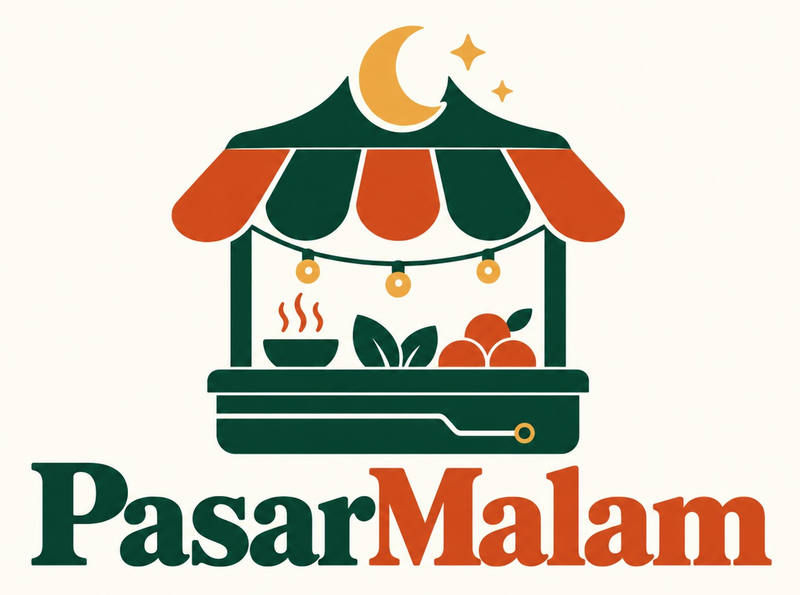
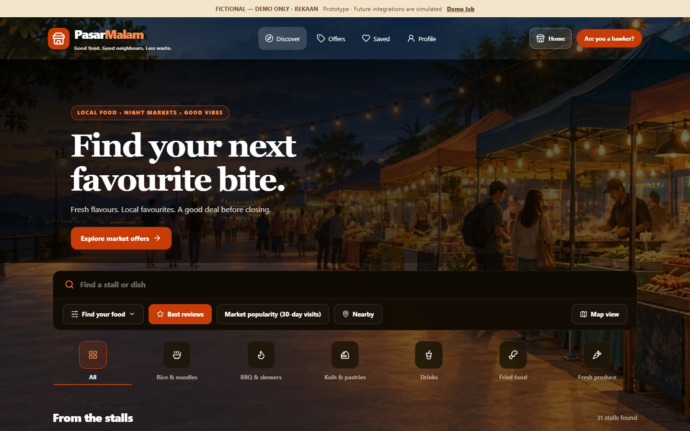
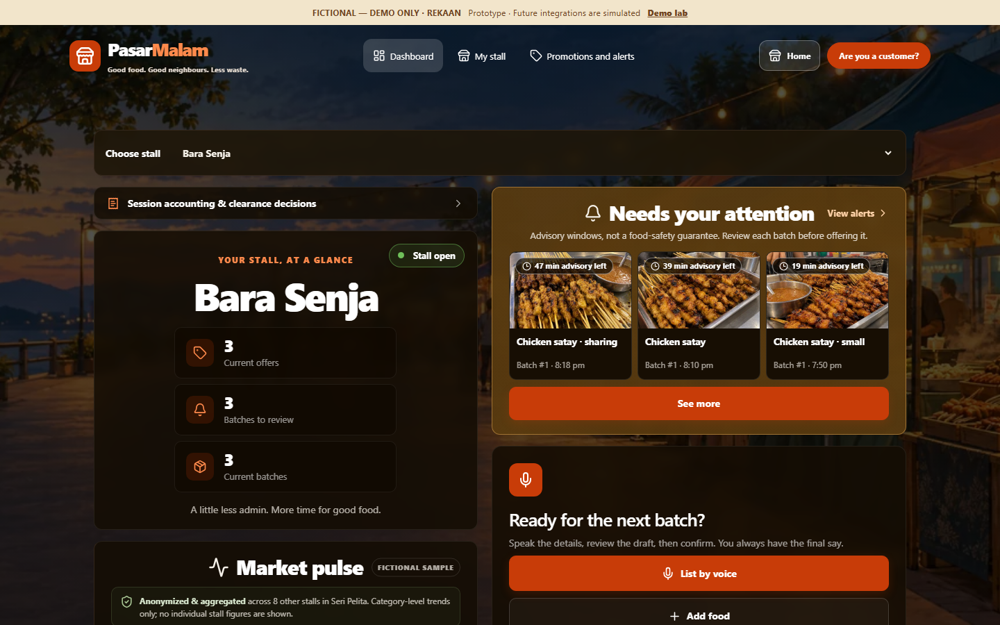
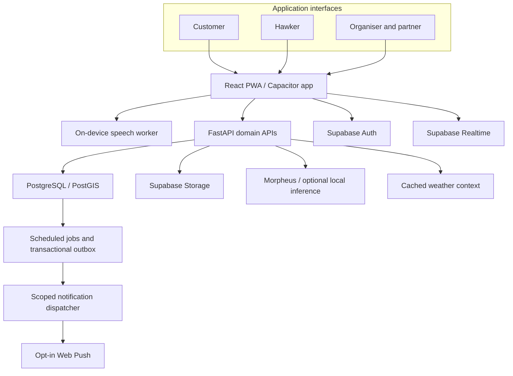

<div align="center">
  

  <h3>Know it's fresh. Make sure it's eaten.</h3>
  <p><em>Good food. Good neighbours. Less waste.</em></p>

  <p>An AI-assisted platform that helps Malaysia's pasar malam hawkers <strong>cut food waste</strong> and show customers <strong>how fresh their food really is</strong>.</p>

  <p>
    <a href="https://pasar-malam-utm.vercel.app/"><strong>▶ Live demo</strong></a> ·
    <a href="https://drive.google.com/file/d/17tNo2qib6LsDg4V3mmjMxnBR_IYNVhP-/view?usp=sharing"><strong>🎬 Video demo</strong></a> ·
    <a href="#key-features"><strong>Features</strong></a> ·
    <a href="#app-workflow"><strong>Workflow</strong></a> ·
    <a href="#tech-stack"><strong>Tech stack</strong></a> ·
    <a href="#team"><strong>Team</strong></a>
  </p>

  <p>
    
    
    
  </p>
  <p><strong>React · TypeScript · FastAPI · Supabase · Whisper · Morpheus (Qwen / Gemma) · PWA · Capacitor</strong></p>
</div>

---

## AI EXPO 2026 entry

| | |
| --- | --- |
| **Competition** | AI EXPO 2026 · Faculty of Artificial Intelligence, Universiti Teknologi Malaysia (UTM) |
| **Track** | **AI for Sustainability and Smart Living** |
| **Focus areas** | **Food Waste** reduction and **Food Safety** transparency at community food markets |
| **Team** | TEE HONG XUAN · SAPTTARUBEN A/L KRISHNAN |
| **Supervisor & Advisor** | Dr. Mohd Azri bin Mohd Izhar |
| **Live demo** | https://pasar-malam-utm.vercel.app/ (no sign-up, runs on fictional demo data) |
| **Video demo** | [Watch on Google Drive](https://drive.google.com/file/d/17tNo2qib6LsDg4V3mmjMxnBR_IYNVhP-/view?usp=sharing) |
| **Maturity** | Working MVP with documented evidence supporting **TRL 4** in a controlled software environment ([evidence](docs/TRL4_EVIDENCE.md)) |

---

## The problem

Malaysia's pasar malam, pasar pagi and Ramadan bazaars feed millions every week, but they sit at the meeting point of two problems.

### 🗑️ Food waste

- Malaysia generates about **17,000 tonnes of food waste every day**, according to SWCorp's 2021 figures ([Asia News Network](https://asianews.network/malaysians-continue-to-waste-food-despite-rising-prices/)).
- Of that, about **6,000 tonnes a day was still edible food** in 2025, up from about 5,000 tonnes a day in 2024 (SWCorp via [New Straits Times, June 2026](https://www.nst.com.my/amp/news/nation/2026/06/1463430/malaysians-throw-away-6000-tonnes-edible-food-daily)).
- Hawkers cook in batches and guess how much will sell. Rain, a slow evening or an early sell-out elsewhere leave cooked food unsold at closing. Without an easy way to reach nearby buyers in the last hour, that food is thrown away.

### 🧪 Food safety

- At a market stall, customers cannot tell when a dish on display was cooked, or whether it is a fresh batch or one left over from earlier.
- Hot, humid conditions shorten how long cooked food should be held, but nothing on the stall shows this.
- Complaints today happen on social media, where they can unfairly damage a stall and expose the person reporting.

### Why existing tools don't fit

Hawkers run informal, cash-first businesses. They don't have time to type during a rush and don't use point-of-sale systems. Food-delivery apps list fixed menus, not the batch that was cooked twenty minutes ago.

---

## Our solution

PasarMalam treats each **market**, each **stall** and each **cooked batch** as linked live records:

1. **Hawkers speak, AI fills in the listing.** A hawker says *"nasi lemak ayam, 30 bungkus, siap pukul 6"* in Bahasa Melayu, English or Manglish. On-device speech recognition and an AI extraction model turn it into a draft batch listing (dish, quantity, price, preparation time). The hawker checks and confirms it.
2. **Every batch carries its own clock.** Each batch keeps its original cooking time. A rules engine works out a cautious holding-time advisory using ingredient risk and local temperature and humidity. Customers see when the food was cooked and how long it is advised to be held.
3. **Surplus finds a buyer before closing.** Near closing time, PasarMalam flags batches likely to be left over and suggests a clearance offer. With the hawker's approval, it notifies opted-in customers nearby, who reserve and pay at the stall.
4. **What can't be sold is still recorded.** Leftovers that can still be eaten are routed to donation and community collection records. Compost and black soldier fly processing are tracked separately from food meant for people.

> **AI suggests, people decide, rules protect.** AI drafts listings and estimates, but only the hawker can publish, and only the deterministic rules engine can set a food deadline. No AI output can extend a freshness window.

---

## Impact on sustainability and smart living

| Goal | How PasarMalam contributes |
| --- | --- |
| **Less food waste** (SDG 12.3: halve food waste per person) | Last-hour clearance offers, reservations, donation handoffs and recorded diversion figures at market level |
| **Safer food choices** (SDG 3: good health and well-being) | Batch-level cooking timestamps, holding-time advisories, handling history and private food-safety reporting |
| **Smarter community markets** (SDG 11: sustainable cities and communities) | One live map of markets, stalls and batches, plus aggregated Market Health reports for organisers and councils |
| **Inclusive livelihoods** (SDG 8: decent work and economic growth) | Free basic tools, voice input in the language hawkers speak, and recovered income from food that would otherwise be thrown away |

---

## Key features

### For customers

- **Live market map and discovery:** find pasar malam, pasar pagi and stalls nearby, then search by market, stall or dish. Filter by distance, category, price, rating, promotions and halal declaration.
- **Freshness at a glance:** each batch shows when it was cooked, a holding-time advisory countdown and its handling history through a QR-linked **batch passport**.
- **Clearance offers:** reserve discounted surplus portions near closing time, then collect and pay at the stall with a collection code.
- **Estimated clearance outlook:** a cautious "likely to sell out soon" estimate with a High / Medium / Lower confidence label, kept separate from confirmed offers.
- **Market Run Planner:** pick saved stalls and get a suggested order based on which stalls close soonest and how far apart they are.
- **Fair, private reporting:** report a food-safety concern confidentially. The hawker gets a right of reply, and the reporter's identity stays hidden.
- **Bahasa Melayu and English** throughout, with voice input in BM, English and Manglish.

### For hawkers

- **List by voice:** speak a batch and get an editable draft with per-field confidence indicators. Quick-entry chips and manual fields are always available as a fallback.
- **Add dishes from a photo:** turn a menu photo into editable dish drafts that the hawker reviews before saving.
- **Batch management:** numbered batches with their own cooking time, stock, photos and correction history. Updating stock never resets the cooking time of older food.
- **Closing-time assistant:** reminders, clearance drafts and approval-based offers for eligible surplus.
- **Market Pulse and planning:** anonymised, category-level trends from the same market, plus history-based suggestions on how much to cook.
- **Session accounting:** sales, collections, stock reconciliation and exports for each trading session.

### For organisers, councils and partners

- **Market Health report:** a printable summary of estimated food diverted, clearance recovery, participating hawkers, visits and reporting coverage.
- **Moderation and case handling:** reviewed food-safety concerns, independent evidence checks and authority referral records.
- **Surplus coordination:** pickup scheduling, handoff receipts and recorded recovery outcomes for community collectors.
- **Labelled sponsored discovery:** campaign controls with capped slots that never override dietary, halal or freshness filters.

---

## App workflow

### End-to-end flow: from the cooking pot to a customer instead of the bin

```mermaid
flowchart LR
    A[Hawker cooks a batch] --> B[Speaks or snaps it<br/>BM · English · Manglish]
    B --> C[On-device speech<br/>Whisper]
    C --> D[AI extraction<br/>Qwen via Morpheus]
    D --> E{Hawker reviews<br/>and confirms}
    E -->|Confirmed| F[Live batch with<br/>its own cooking time]
    F --> G[Rules engine sets<br/>holding-time advisory<br/>ingredients + weather]
    G --> H[Customers discover<br/>on map and search]
    H --> I{Selling well?}
    I -->|Sold out| J[Session accounting]
    I -->|Surplus near closing| K[Clearance suggestion]
    K --> L{Hawker approves}
    L --> M[Nearby opted-in<br/>customers notified]
    M --> N[Reserve → collect → pay at stall]
    N --> J
    G -->|Advisory window ends| O[Offer delisted automatically]
    O --> P[Donation / compost<br/>records]
    J --> Q[Market Health report<br/>for organisers]
    P --> Q
```



### Customer journey

1. Open the app and allow coarse location if wanted, or browse by market.
2. Discover nearby markets, stalls and dishes, checking cooking times and advisories.
3. Save favourite stalls and plan a market run.
4. Reserve a clearance offer and get a collection code.
5. Collect and pay at the stall, then leave a review or report a concern privately.

### Hawker journey

1. Set up the stall, menu and opening sessions, or add dishes from a menu photo.
2. During trading, record each new batch by voice or quick entry and confirm the draft.
3. Watch the dashboard for batches that need attention before closing.
4. Approve suggested clearance offers and hand over reserved portions.
5. Close the session, reconcile stock and review Market Pulse insights for tomorrow.

See [APP_FLOW.md](APP_FLOW.md) for the full screen map and route-by-route flows.

---

## Product experience

**Customer interface: discover markets, stalls and food prepared nearby.**



**Hawker interface: manage products, preparation batches, alerts and clearance offers.**



*Product imagery uses illustrative Malaysian market, business and customer data.*

### Try it

| Start here | What you'll see |
| --- | --- |
| [Customer demo](https://pasar-malam-utm.vercel.app/demo/discover) | Discovery, batch freshness, clearance offers and the Market Run Planner |
| [Hawker demo](https://pasar-malam-utm.vercel.app/demo/hawker/login) | Enter any details at the demo login to open the dashboard, voice listing, batches and session accounting |
| [Market Health report](https://pasar-malam-utm.vercel.app/demo/organizer/report) | The organiser's market summary (fictional figures) |

> The `/demo` routes run entirely in the browser on fictional data, with no backend or account needed. Nothing you enter leaves the browser.

---

## AI components

AI is used where it saves hawkers time, and kept out of the decisions that affect food safety.

| AI capability | Model / approach | Human and rules control |
| --- | --- | --- |
| **Speech recognition** (BM, English, Manglish) | Whisper (tiny / small / large-v3-turbo) running **on the device** via Transformers.js in a Web Worker; optional faster-whisper desktop helper | Raw audio is discarded after transcription. Quick-entry and manual fields are always available |
| **Listing extraction** | `qwen35-9b` through the Morpheus API, with JSON-schema validation and evidence from the transcript | Output is an editable draft. Confidence indicators are review aids, and nothing is saved until the hawker confirms |
| **Photo and menu suggestions** | `gemma-4-31b` vision through Morpheus | Suggestions are kept apart from confirmed facts. AI never infers allergens, halal status or food safety from an image |
| **Clearance outlook and cooking forecast** | Transparent heuristics comparing today's preparation volume with historical baselines and the time left to trade | Shown with a confidence label, never creates an offer by itself and never changes a deadline |

**Measured development results** on 24 supplied audio clips per language, using the best desktop configuration: critical-field accuracy of **90% for BM, 86% for Manglish and 95% for English**, with **24 of 24** clips producing valid drafts. These are development measurements, not independent field trials. See [voice accuracy improvements](docs/VOICE_ACCURACY_IMPROVEMENTS.md) for method and limits.

---

## Tech stack

| Layer | Technology | Purpose |
| --- | --- | --- |
| **Web application** | React 19, TypeScript, Vite, React Router | Responsive interfaces for customers, hawkers and organisers |
| **UI and forms** | Plain CSS with shared design tokens and co-located stylesheets (Tailwind CSS v4 is loaded only for its base reset), Radix Dialog, Lucide, React Hook Form, Zod | Accessible controls, validated input and consistent components |
| **Client data** | TanStack Query, Supabase JS | Query caching and realtime-aware refresh |
| **Maps and languages** | Leaflet, OpenStreetMap tiles, i18next | Geographic discovery and BM / English interfaces |
| **Speech recognition** | Transformers.js with Whisper ONNX in a Web Worker; optional faster-whisper helper on `127.0.0.1:8020` | Private, on-device transcription |
| **AI assistance** | Morpheus with Qwen (text) and Gemma (vision) adapters; optional local Qwen through llama.cpp | Structured extraction and reviewed image suggestions |
| **Backend** | Python 3.12, FastAPI, Pydantic, Uvicorn, HTTPX | Typed APIs, domain validation and provider adapters |
| **Data platform** | Supabase PostgreSQL, PostGIS, Auth, Storage, Realtime | Relational and geographic data, identity, media and live updates |
| **Weather context** | Open-Meteo with shared caching | Market-area temperature and humidity for advisories |
| **Jobs and notifications** | pg_cron, pg_net, SQL outbox, pywebpush, VAPID | Scheduled closing-time monitoring and opt-in Web Push |
| **Media and mobile** | Pillow, WebP, PWA service worker, Capacitor (Android / iOS) | Responsive photos, offline support and native app builds |
| **Deployment** | Vercel (web), Railway (API), Supabase (data) | Separate web, API and data responsibilities |
| **Engineering tools** | npm, uv, TypeScript, ESLint, Ruff, Vitest, pytest | Reproducible dependencies and code-quality checks |

### Architecture



The browser handles presentation, maps, transcription and input review. FastAPI validates commands and isolates calls to outside providers. PostgreSQL holds domain records and runs transactional checks, and scoped realtime events refresh the views that need it. Scheduled jobs and the notification outbox let closing-time assistance keep working after the hawker closes the app.

### Food-safety rules engine

- Freshness eligibility uses **versioned rules anchored to the original cooking time**. Ingredient risk, area temperature, humidity and uncertainty only ever *shorten* the window. Missing information shortens or blocks an advisory.
- Weather describes market-area conditions, not the measured temperature of the food.
- LLMs may explain a result but **cannot set or extend a deadline**. Offers, edits and merged stock cannot reset old food's cooking history.
- Expired batches become ineligible for clearance, and their offers are delisted automatically.
- The countdown is an **advisory**, not a guarantee of safe consumption or a safety certification.

### Data integrity, security and privacy

- The domain model links **markets, stalls, menus, numbered batches, promotions, reservations, reviews, reports and partner cases**. Each batch keeps its own cooking time, photos and audit history.
- Collection and stock commands use transactional checks and idempotency keys to prevent duplicate actions and overselling.
- Supabase Auth, membership checks, role-scoped APIs, row-level security and Storage policies restrict access. Public listings are separated from confidential reports and reporter identities.
- Photos are converted to responsive WebP with metadata stripped. Voice recordings are discarded after transcription, and AI providers only receive consented, redacted text.
- Provider credentials stay on the backend, never in the browser.

---

## Business model

Basic discovery and hawker listing tools stay **free**. Revenue comes from visibility, completed surplus sales and insight.

| Revenue stream | Offering | Value |
| --- | --- | --- |
| **Clearance commission** | A small commission on *completed* reserved clearance sales, paid at the stall | Hawkers recover income from food that would otherwise be thrown away |
| **Sponsored placements and ads** | Labelled stall promotion and market campaigns with capped slots | Local reach for hawkers and brands |
| **Organiser and council subscriptions** | Market Health dashboards: activity, hygiene patterns, waste diverted and hotspots | Better coordination and evidence for sustainability reporting |
| **Premium hawker insights** | Demand forecasts, cooking recommendations and stock analysis | Fewer leftovers through better cooking decisions |

Sponsored placement never overrides dietary, halal or freshness filters. A reservation alone is not counted as a sale. Recovery figures keep recorded quantities, estimated weights and confirmed collections apart.

### Who it serves

| Audience | Value proposition |
| --- | --- |
| **Customers** | Find local favourites, see how fresh the food is, save stalls, reserve affordable surplus and report concerns safely |
| **Hawkers and vendors** | List batches by voice in seconds, track stock, sell surplus before closing and cook smarter tomorrow |
| **Market organisers and councils** | Coordinate markets, review private concerns, manage permits and measure food-waste diversion |
| **Food media, brands and surplus collectors** | Reach local audiences and coordinate surplus collection |

### Market positioning

| Differentiator | Why it matters |
| --- | --- |
| **Market-first discovery** | Customers find the market, its stalls and today's food together, unlike delivery apps with fixed menus |
| **Voice in BM and Manglish** | Listing fits how hawkers actually talk during a busy session |
| **Batch-level freshness** | Each batch's cooking record separates newly cooked food from older stock |
| **Rules-backed clearance** | Surplus offers are subject to stock and deadline checks, and the hawker controls publishing |

The model has a network effect. More stalls make discovery more useful, and more local customers make last-hour clearance offers more likely to sell. Market organisers and neighbourhood communities are natural distribution channels.

### Partner ecosystem

| Partner category | Business use |
| --- | --- |
| **Market organisers and local councils** | Market administration, permit coordination and scoped operational reporting |
| **Health and food-safety authorities** | Reviewed complaint referrals and case records with controlled access to evidence |
| **Community and surplus collectors** | Pickup coordination, handoff receipts and recorded recovery outcomes |
| **Food media and brands** | Editorial collections, creator collaborations and local campaigns |

These categories describe integration opportunities. They do not imply an endorsement or official partnership with any named organisation.

---

## Trust and inclusion

- **Preparation transparency:** show batch times, handling history and advisory windows without claiming food is "safe".
- **Halal transparency:** keep hawker declarations separate from reviewed certification, and never infer religion or ethnicity from stall names or images.
- **Fair reporting:** require verified accounts and rate limits, keep early reports private, check independent evidence before any public flag, and provide replies and appeals.
- **Transparent sponsorship:** label promotions, cap sponsored slots and respect the customer's filters.
- **Privacy by design:** opt-in coarse location, consented AI sharing and restricted complaint evidence.
- **Accessible participation:** free basic tools, large touch targets, familiar language, and voice or manual input for hawkers with little time to type.

---

## Validation and maturity

| Area | Status |
| --- | --- |
| **Technology readiness** | Documented evidence supporting **TRL 4**: critical components integrated and functionally validated in a controlled software environment ([TRL 4 evidence](docs/TRL4_EVIDENCE.md)) |
| **Integration testing** | Connected browser, API and database workflows for onboarding, discovery, voice-to-batch, batch passports, clearance and moderation (acceptance reports in [`docs/`](docs/)) |
| **AI evaluation** | Development voice results of BM 90%, Manglish 86%, English 95% and 24 of 24 valid drafts on supplied clips |
| **Not yet established** | Operation in a real market, approved food-holding thresholds, phone performance under market noise, and real-user impact |

**Next steps:** pilot with hawkers at a real pasar malam, run independent voice tests on phones in market noise, review holding-time rules with qualified food-safety advisers, and measure actual food diverted.

---

## What's new (October 2026)

| Area | What changed |
| --- | --- |
| **New brand identity** | A stall-and-crescent logo across the web app, PWA icons, and Android and iOS launcher icons and splash screens |
| **Night-market redesign** | A dark night-market theme across customer and hawker pages, one shared site header, a phone bottom bar and slide-up page transitions that respect reduced-motion settings |
| **Discover** | Search and filters first, redesigned food cards, a *Featured stalls* row, grouped filters that apply instantly and a preview of clearance estimates |
| **Estimated clearance** | A transparent "likely to sell out soon" heuristic with a confidence label, **not** a machine-learning prediction. It never creates an offer or changes a freshness deadline |
| **Batch lifecycle** | A recorded timeline for each batch, one primary action per batch state and per-field voice confidence indicators |
| **Hawker workspace** | Redesigned Dashboard, My stall, Promotions and alerts, List by voice, Planning and Session accounting, with 44–48 px touch targets |
| **Photo menu onboarding** | *Add dishes from a photo* produces editable drafts for hawker review (simulated in the browser for the demo) |
| **Market Pulse** | Anonymised category-level trends in the same market with a suggested cooking adjustment |
| **Market Run Planner** | Customers order saved stalls by closing windows and distance, then mark stops as visited |
| **Market Health report** | A printable organiser summary, now linked from the Profile hub |

---

## Run locally

Requirements: Node 24, npm, and uv with Python 3.12.

```powershell
# Install locked dependencies (repository root)
npm ci
uv sync --frozen --project apps/api

# Web app: the /demo routes need no backend or keys
npm run dev
# then open http://127.0.0.1:5173/demo  (redirects to /demo/discover)

# API (only for connected mode): operator settings go in the ignored apps/api/.env
./scripts/start-local.ps1 -Service api      # http://127.0.0.1:8010/health

# Optional desktop speech helper for the voice page (127.0.0.1:8020)
./scripts/start-speech-helper.ps1
```

Public browser settings go in the ignored `apps/web/.env.local` (copy `.env.example`). Never commit `.env` files or put secret keys in `VITE_` variables. See [docs/local-operations.md](docs/local-operations.md) for the full connected setup.

**Deployment:** the web app is deployed on Vercel at https://pasar-malam-utm.vercel.app/ ([`vercel.json`](vercel.json)), and the FastAPI service is configured for Railway ([`railway.toml`](railway.toml), [`Dockerfile`](Dockerfile)).

**Mobile builds:** run `npx cap sync` in `apps/web`, then open the Android or iOS project in Android Studio or Xcode.

---

## Team

| Role | Name |
| --- | --- |
| Team member | **TEE HONG XUAN** |
| Team member | **SAPTTARUBEN A/L KRISHNAN** |
| Supervisor & Advisor | **Dr. Mohd Azri bin Mohd Izhar** |

Faculty of Artificial Intelligence, Universiti Teknologi Malaysia, AI EXPO 2026.

---

<div align="center">
  <sub>Demo data, market names, partner offices and figures shown in the app are fictional and for demonstration only.<br/>Holding-time advisories are decision aids, not food-safety certifications.</sub>
  <br/><br/>
  <strong>PasarMalam:</strong> <em>Know it's fresh. Make sure it's eaten.</em>
</div>
