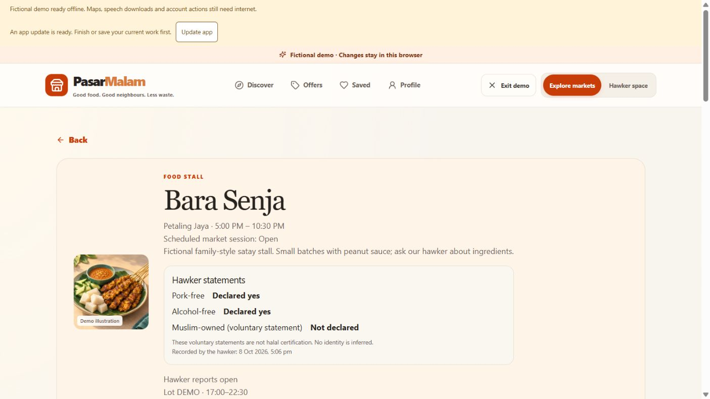

# CP1 — listing details and customer onboarding

8 October 2026 · **Local code and focused gate complete; registration-policy and human acceptance remain pending.** Deployment is on hold.

CP1 closes three consolidated requirements: `C03-07` (declarations versus certification), `C04-01` (dedicated stall description) and `C04-09` (confirmed/unknown allergens). `C01-03` remains partial because the public-versus-invite registration policy and a human email/password onboarding journey have not been accepted.

## Delivered

- Dedicated 1,000-character stall description, separate from specialty, in hawker forms, demo persistence, guarded vendor API/SQL and customer discovery/detail.
- Explicit yes/no/unknown pork-free, alcohol-free and voluntary Muslim-owned statements. Existing evidence/review/expiry certification logic stays independent; declarations never satisfy certified-halal filtering or infer identity.
- Explicit confirmed/unknown allergen statements with ten selectable codes, unknown/possible cross-contact, server recording time and private actor/source audit. The selector is not exhaustive; an empty list is not an allergen-free guarantee.
- Ingredient edits clear confirmation. The SQL trigger covers voice/operator paths too; explicit manual reconfirmation is saved afterwards in the same transaction. Voice strips allergen fields and cannot reconfirm them. Older clients preserve descriptions/declarations when omitted and clear allergens only when ingredients change.
- Config-gated public-registration adapter, email confirmation/invitation verification and bounded validation/errors. Duplicate emails receive a neutral message. Default `VITE_ENABLE_PUBLIC_REGISTRATION=false`; current API always reports `registration_policy=invite-only` and `data_environment=disposable-demo`.
- Verified invited-user onboarding to the **customer** role, independent of browser role/mode/user metadata. New uninvited profiles are refused even if a provider signup endpoint is reachable. Existing assigned users keep their permissions; vendor/organiser grants remain protected.
- English/BM labels, compatible fixture scenarios and an [owner-reviewable privacy draft](CP1_PRIVACY_REVIEW.md). Demo Profile explains that fictional accounts do not create real accounts.

## Database and contracts

Applied two **new** guarded disposable migrations:

1. `20261008120000_cp1_listing_onboarding.sql`: columns, strict JSON validation, private audit, verified customer onboarding, public projection and vendor RPC/workspace updates.
2. `20261008121500_cp1_invited_admission.sql`: invitation requirement for newly provisioned disposable profiles.

Previously applied migration files/checksums were preserved. Existing fictional descriptions were backfilled from specialties; no identity/allergen confirmation was inferred. No seed reset, batch-time reset, public Auth policy change, real invitation or deployment was performed. OpenAPI and generated TypeScript contracts were regenerated.

The local API was refreshed on `127.0.0.1:8010` to load CP1. The existing frontend remains on `127.0.0.1:5174`.

## Phase-end evidence

The whole code batch was built before its gate. No watch mode or repeated full-suite runs were used.

| Check | Actual result |
| --- | --- |
| `npm run lint` | Passed |
| `npm run build` (includes TypeScript) | Passed after rerunning outside the filesystem sandbox; the first Vite attempt could not resolve its installed module |
| Selected Vitest files: listing declarations, registration, vendor transactions, discovery engine, voice model | **78 passed**, five files; 11 new CP1 cases |
| Ruff on affected app modules, CP1 tests and gate script | Passed after three formatting repairs |
| `uv run --project apps/api python scripts/cp1_gate.py` | **21 passed**, including **4 actual connected CP1 tests**; 9 new CP1 cases total and 12 existing vendor regressions |
| `node scripts/check-web-secrets.cjs` | Passed |
| Browser walkthrough | Saved description/declarations; saved confirmed Peanuts/Soy; customer showed confirmation time and unknown other dishes; ingredient edit cleared checkbox and saved unknown; explicit reconfirmation restored it; sandbox displayed invite-only controls and BM labels |
| Refreshed localhost API | Config reports `invite-only` / `disposable-demo`; discovery returns 32 stalls and 95 menu items with description, declaration and allergen fields |
| Document gate | 97 checked / 54 open; all 54 open IDs mapped once; relative links and evidence image valid |

Connected tests exercised owner/foreign denial, public projections, direct-RPC invalid declarations, anonymous/direct-write denial, idempotent retry and conflict, server-controlled timestamps, omitted-field compatibility, ingredient-change invalidation, unverified/uninvited refusal and customer-only admission despite forged privileged metadata. New listing fixtures were cleaned up; private audit entries remain as evidence. The synthetic Auth row used for admission tests was rolled back. No email was sent and no browser password was changed.

Build warnings were existing Zod annotation removal and a large bundle; pytest reported the existing Starlette/httpx deprecation warning. They did not fail the gate. The frontend credential scan covers the final built artifact. This is focused CP1 acceptance, not a claim that all project tests or real-device gates were rerun.

## Still open before registration/real-data acceptance

- [ ] Owner decides whether registration should remain organiser-invited or offer public self-registration on a future approved isolated target. No public signup is currently available.
- [ ] On that approved target, confirm Auth email verification, allowed redirect/template settings and the production data boundary. A frontend flag alone is insufficient; this disposable backend deliberately cannot advertise public production registration.
- [ ] A consenting tester completes an actual invitation/confirmation email → profile → password setup → sign-in journey and verifies expiry/error UX. The tester must enter/set their own password. Automated token cases and transactional SQL admission are already tested; they are not an email-delivery claim.
- [ ] Human owner/privacy review of the [draft](CP1_PRIVACY_REVIEW.md), including sensitive voluntary ownership declarations, provider arrangements and new audit retention, before real participants or businesses are collected.

For the current fictional sandbox, a verified invitation hash is entered under **Profile → New account or invitation**. The UI accepts `token_hash` from an email link and keeps it in memory only; it does not consume arbitrary URL session tokens or store passwords. No API keys or deployment action are required to continue CP2.
