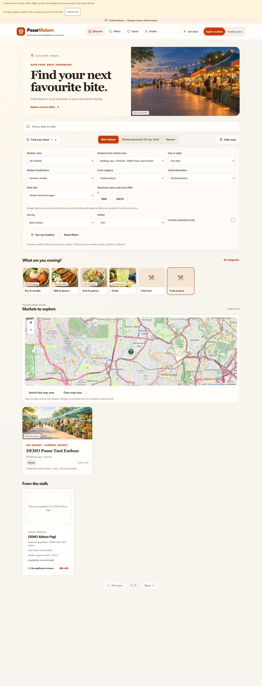
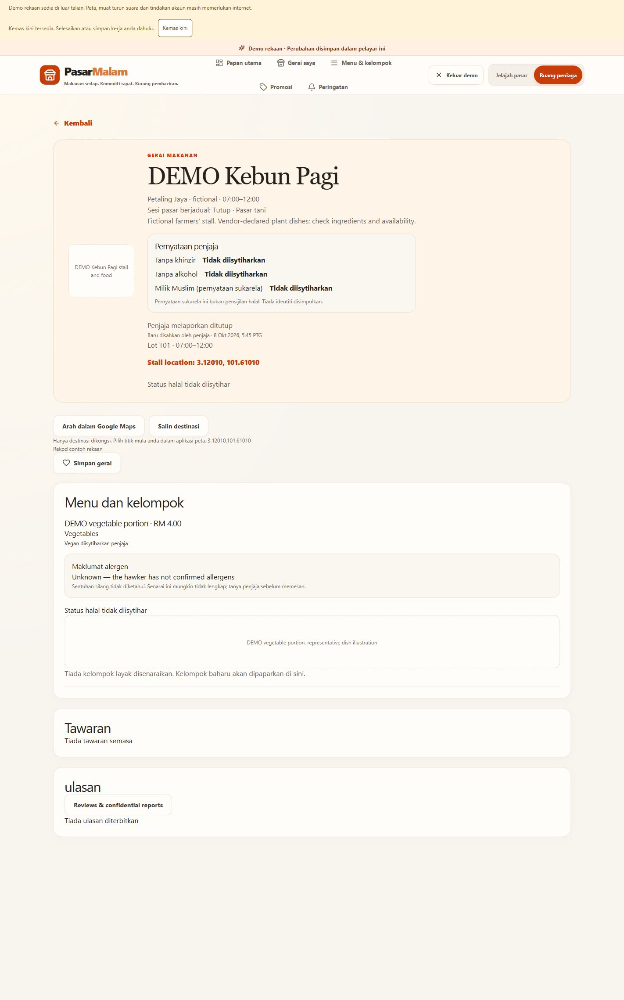

# CP2 — market discovery and filters

8 October 2026 · **Complete locally; 0 remaining CP2 tasks.** Deployment is on hold.

Closed requirements: `C02-01`, `C02-07`, `C02-08`, `C02-09`, `C03-05`, `C03-08`, `C03-10`. Consolidated status: **104 checked / 47 open**. CP1 human registration/privacy acceptance and later phases remain open.

## Delivered

- `kind=general|farmers` is independent of `type=day|night`. Existing markets default to general; a dedicated fictional **DEMO Pasar Tani Embun / DEMO Kebun Pagi** journey has seven daily morning schedules, coordinates and a RM4 vegetable menu item. List, detail, classification filter and map pin use the same data.
- [Shared taxonomy](../contracts/food-categories.json): stable `rice`, `skewers`, `kuih`, `drinks`, `fried`, `produce` IDs. Legacy Rice, Skewers, Bread/Desserts and other documented aliases remain compatible. Existing non-null menu associations are preserved; missing associations inherit the stall category. Hawkers can change menu categories individually. No food ingredients infer category or diet.
- Vegetarian/vegan are explicit vendor yes/no/unknown statements. Vegan is included by vegetarian filtering; vegan=yes with vegetarian=no is a conflict and excluded. Unknown does not qualify. Ingredient edits clear declarations, including voice/operator paths; manual reconfirmation writes a server time/private audit. Halal and allergens remain separate.
- RM5/RM10/custom budget is an **inclusive maximum price of one listed menu item before offers**. The same menu item must match category, plant diet and price. Free/BOGO/multi-unit promotions never substitute their bundle price into the menu filter. It is a listed-price filter, not a claim of live stock or a reservation; the existing batch/clearance eligibility engine still applies independently.
- Scheduled opening-soon remains two hours. Closing-soon is the final 30 minutes of an active session; close is exclusive. Malaysia-time overnight sessions, opening-day cancellations, exceptions and overlapping sessions are covered. Another active session ending later keeps the market open. Hawker open/closed reporting remains a separate signal.
- **Confirm current availability** is an explicit hawker action. Server/demo clock controls the timestamp; retry keys keep it unchanged. Ordinary edits, snapshot fetches and realtime invalidations do not reconfirm. Changing stall open/closed clears confirmation. Unknown/future timestamps are unknown. Default stale age is 30 minutes, inclusive; `availabilityState(at, now, maxAgeMinutes)` provides the configurable threshold, with the shared default in [classifications.ts](../apps/web/src/discovery/classifications.ts). Confirmation is a last-known availability statement, not a food-safety or inventory guarantee.
- Market/stall directions validate finite coordinate pairs within ±90/±180. A missing stall pin falls back to the market entrance with an explicit label; a destination without coordinates has no navigation link. Users can copy the displayed destination even without GPS. The URL includes only `api=1` and `destination`; this app never appends a precise shopper origin. The external map controls its own permissions/start point. URL construction follows [Google’s official Maps URL documentation](https://developers.google.com/maps/documentation/urls/get-started#directions-action).
- Existing sponsorship caps/labels, halal and batch/clearance rules are retained. Sponsored selection uses the same discovery filters, and map/card results remain the same page. List fallback survives tile failure. English/BM copy is supplied for CP2 controls and labels.

## Database and compatibility

Applied **one new guarded migration**, `20261008130000_cp2_discovery.sql`; existing applied checksums remain untouched. It adds classification, category/plant/availability fields, backfill, protected triggers/audit and public/vendor projections. Previous CP1 command/workspace bodies are private compatibility helpers, called through the extended public wrappers. Owner checks, actor locking and retry fingerprints remain authoritative; helper execution is revoked from anon/authenticated.

The new fake market/stall/menu are additive, with existing vendor-a membership and no new Auth account, certification, review or batch reset. Existing browser demo edits are preserved; the CP2 addon is idempotently available to old stored demos. The original 30-stall catalog stays intact, plus the addon. No new imagery was generated: unmatched vegetable/stall/batch subjects have descriptive placeholders.

Regenerated OpenAPI and TypeScript contracts. Refreshed API at `127.0.0.1:8010`; frontend remains `127.0.0.1:5174`. Local public endpoint returns **33 stalls / 96 menu items**, including one farmers market.

## Phase-end gate

The implementation batch was completed before tests. No watch mode or repeated full-suite gate was run.

| Check | Actual result |
| --- | --- |
| ESLint, TypeScript and production Vite build | Passed |
| Selected frontend gate | **91 passed**: 73 existing discovery/vendor/declarations/voice cases and 18 new CP2 cases |
| `uv run --project apps/api python scripts/cp2_gate.py` | **26 passed**: 2 CP2 model + 3 actual connected CP2 cases + 21 CP1/vendor regressions |
| Ruff on affected modules/tests/gate | Passed |
| Final built frontend credential scan | Passed |
| Refreshed local public endpoint | 33 stalls / 96 menu items / 1 farmers market |
| Browser walkthrough | Combined farmers + 1 km + produce + vegan + RM5 returned RM4 item and one matching pin; RM3 returned none. Market and stall directions show distinct destinations; copy displayed success. Hawker confirmed availability, timestamp appeared; category/plant form controls loaded; BM availability/diet/directions displayed correctly. Temporary tab closed and original English/customer preferences restored. |
| Document gate | 104 checked / 47 open; every open requirement mapped exactly once |

First frontend CP2 test import reached browser-only UI code; sponsorship selection was separated into a pure module and only the failed CP2 file rerun. The other 73 frontend passes were retained. Formatting-only Ruff failures were repaired and rechecked. Backend passed its first test run; no backend test rerun was needed. Existing Zod/chunk-size and Starlette/httpx warnings remain non-failing.

Connected cases prove public farmer/taxonomy projection and backfill, owner-only availability, timestamp spoof rejection, retry/ordinary-edit/refresh semantics, open-status invalidation, ingredient reset/manual plant reconfirmation, workspace fields and invalid category rejection. Their new listing rows were cleaned up; private audit entries remain. No real email, precise-location permission, actual navigation trip, paid AI call, partner action, deployment or physical-phone validation was performed.

## Remaining

- [x] All CP2 local tasks and seven mapped requirements complete.
- [ ] CP3 voice targeting/clarification/readback is the next coding phase.
- [ ] CP1 registration-policy, human email/password and privacy acceptance remain tracked independently.
- [ ] Human/device, expert-policy and real external agreement acceptance in later phases remain open. CP12 deployment stays last and held.
