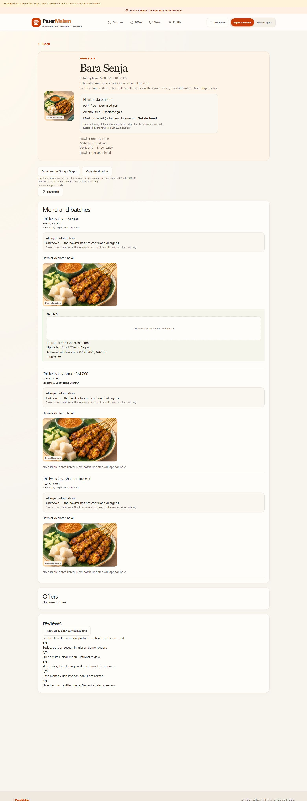

# CP3 — voice workflow acceptance

8 October 2026. **Local code and focused gate complete.** Three source requirements closed: `C05-04`, `C05-07`, `C05-09`. `C05-05` remains human-acceptance pending. Consolidated totals: **107/151 checked, 44 open**. [Plan](COMPLETION_IMPLEMENTATION_PLAN.md).

## Implemented

- Extract suggested stall, dish, batch reference and price basis. Connected extraction scopes names to the authenticated hawker's workspace. Exact owned IDs remain required; ambiguous/duplicate targets require selection.
- Separate new ambient batch, menu-only update and existing-stock reduction. No timer edits, implicit second-pan reset, stock increase or foreign batch writes. Stock consumes through the existing protected ledger and does not overwrite menu, preparation time or advisory deadline.
- Deterministic BM/Manglish remaining quantities and bundle-price uncertainty. “Dua seringgit” prompts confirmation of meaning and ONE menu-unit price; this flow does not create a bundle promotion. “Kuali kedua” stays unsupported until an explicit new draft resolves intent.
- Field-specific questions and date/AM/PM confirmation, bounded redacted correction history, final action approval and original extraction evidence. Audio/transcription stays local; external text extraction remains opt-in. Quick-entry chips work without a provider.
- User-triggered English/BM summary readback and visible-text fallback when matching voices are missing or fail. Stale speech callbacks cannot overwrite save status. Forms/audio controls lock during an unresolved save; retries reuse the exact command/request.
- Atomic SQL/demo-adapter writes with retry fingerprints, ownership and optimistic stock checks. Exported OpenAPI/browser contracts and synthetic adversarial fixtures; expanded consenting held-out recording brief.

## Phase-end verification

Built the phase before running selected tests; no watch/full-suite loop. Initial failures in lint and fixture cleanup were repaired, then only affected checks were repeated. Distinct successful cases across the batches:

| Check | Result |
| --- | --- |
| `npm run lint` and `npm run build` | Pass; final build after browser status/locking fixes |
| `npm run test -w @pasarmalam/web -- src/voice/workflow.test.ts src/voice/model.test.ts src/vendor/model.test.ts` | 55 passed |
| `uv run --project apps/api python scripts/cp3_gate.py` plus affected connected retry | 39 distinct backend cases passed: 34 non-connected and 5 connected |
| `RUN_LIVE_CP3=1` selected `test_cp3_live.py` final retry | 5 passed; menu/new-batch/stock ownership, retry, stale count, preserved time and direct-RPC null guards |
| Ruff on changed voice modules/tests/gate | Pass |
| `python scripts/export_contract.py` | OpenAPI/browser contracts regenerated |
| `node scripts/check-web-secrets.cjs` | Pass after final production build |
| Guarded SQL migration and permission readback | 27 migrations recorded; two new CP3 migrations, prior checksums preserved |
| Fixture cleanup readback | 33 public stalls / 96 menu items; failed test fixtures removed by exact IDs |
| Browser text/quick-entry flow | Pass: time question blocks; explicit new batch; English readback start observed; stock reduction; customer batch audit |

The two additive migrations are `20261008095630_cp3_voice_workflow.sql` and `20261008101017_cp3_command_guards.sql`. Anonymous function execution is denied; authenticated execution has ownership/role validation. Private retry-table RLS is enabled and browser roles have no table privileges. The Supabase security-advisor connector was unavailable because project access was denied; the local SQL permission checks passed, but this is not a full advisor report.

The React review covered stable hook order, worker/voice cleanup, explicit labelled inputs, bounded history, pending-command locking and cache invalidation. Existing bundle-size/Zod annotation and Starlette/httpx deprecation warnings remain non-blocking; no new dependency or paid service was introduced.

## Browser evidence

Local production preview on `http://127.0.0.1:5174/demo/hawker/voice`, backed by fictional browser data. Backend on `127.0.0.1:8010` refreshed for CP3. No deployment.

A fictional spoken-style text draft targeted Bara Senja / Chicken satay. “Sepuluh batang” became 10 sticks; “pukul enam” required explicit Malaysia date/AM/PM. After explicit preparation-now choice and approval, Batch 3 was created at 6:12 pm. A second draft selected its exact ID and reduced stock to 5. The public customer screen retained the 6:12 pm preparation and 6:42 pm advisory end; no fourth batch was created by stock update. Batch artwork remains a described placeholder rather than evidence of newly cooked food.

The final-build bundle check displayed the explicit two-for-RM1 question with an empty unit price and disabled confirmation. [Clarification screenshot](screenshots/cp3-voice-review.png).

## Remaining and limitations

**No remaining CP3 local code job.** Human held-out expression accuracy (`C05-05`) remains unchecked for CP7. This phase used synthetic text and automated validation, not consenting microphone recordings or a new live Morpheus benchmark. No measured speech accuracy, human comprehension or posting-time improvement is claimed. Actual BM browser audio availability varies; matching-language fallback is tested deterministically and visible summaries are provided.

Follow the [recording guide and CP3 held-out supplement](VOICE_RECORDING_GUIDE.md). CP4 is next. Registration/privacy acceptance, qualified food-policy review and subsequent completion phases remain tracked in the [44-item inventory](PARTIAL_AND_PENDING_JOBS.md). Deployment remains on hold.
