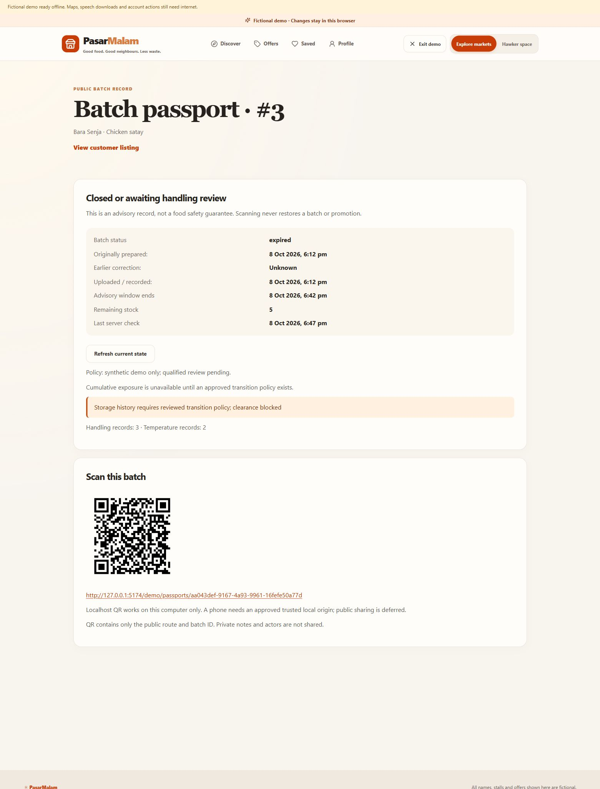

# CP4 — passport and handling acceptance

8 October 2026. **Available local passport/recording implementation and focused gate complete.** Closed: `C06-10`, `C06-11`, `C07-12`. Pending: `C07-01` qualified food-policy approval and `C07-13` the approved cumulative-exposure algorithm/parity implementation. Consolidated totals: **110/151 checked, 41 open**. [Completion plan](COMPLETION_IMPLEMENTATION_PLAN.md).

## Delivered behaviour

Public `/passports/:id` routes show published stall/dish/batch context, original preparation/upload times, earlier correction, advisory deadline, quantity, current status and recording counts. Expired/closed context remains visible without restoring inventory or offers. Unknown/unpublished context is unavailable. Public payloads contain no private notes, recorder IDs, individual measured temperatures or instruments. Connected reads are server-current and no-store; the UI periodically refreshes and treats unavailable/offline/stale state as unavailable rather than eligibility evidence.

Owner `/hawker/handling/:id` records are append-only, including effective and server-recorded times, manual source and actor audit. Temperatures keep original °C/°F, value and method; conversion is display-only. Corrections reference an original from the same batch/type, need a reason, preserve the original and disallow conflicting correction branches. Future/pre-preparation records and invalid measurements are rejected. Bounded request fingerprints provide exact retries/conflict rejection.

Any recorded storage transition blocks clearance pending reviewed interval rules, including later ambient declarations. Existing offers are withdrawn; existing preparation time is preserved and deadlines never increase. Restore and merge are guarded in both adapters and database triggers; trigger checks also protect underlying older command implementations and fresh migration ordering. The cumulative value stays unavailable, with explicit pending-review explanation. Existing weather/synthetic sensors remain separate.

QR uses the existing Python qrcode library, pinned as runtime dependency `qrcode==8.2`; no new paid service. It encodes only the public URL/batch ID at an allowlisted current frontend origin. Same-computer localhost use works. No LAN/public origin or deployment was activated. A phone scan still needs an approved reachable trusted origin and real device acceptance.

## Focused phase gate

The whole phase was built before testing. Initial formatting issues were fixed. The boundary review added restore/merge protection, followed only by affected static/build/domain/connected retries; successful unrelated suites were not rerun.

| Command/check | Actual result |
| --- | --- |
| `npm run lint` and `npm run build` | Pass, including final affected build |
| `npm run test -w @pasarmalam/web -- src/passports/model.test.ts src/freshness/engine.test.ts src/vendor/model.test.ts` | 68 passed across 3 files |
| `uv run --project apps/api python scripts/cp4_gate.py` | 25 passed: 24 non-connected and 1 connected CP4 journey |
| `RUN_LIVE_CP4=1` affected `test_cp4_live.py` retry | Pass after wrapper/trigger boundary additions; same journey includes lower-level trigger checks |
| Ruff changed passport/main/tests/gate | Pass |
| `python scripts/export_contract.py` | API/browser contracts regenerated |
| `node scripts/check-web-secrets.cjs` | Pass after final build |
| Guarded migration/checksum and permission readback | Pass; 30 migrations total; original checksums preserved |
| Connected fixture cleanup | 33 public stalls / 96 menu items retained |
| Browser | Manual measurement → append correction → storage transition → private history → public blocked passport/QR passed |

Three migrations: `20261008102120_cp4_batch_passports.sql`, `20261008103425_cp4_no_restore_merge.sql`, `20261008103711_cp4_transition_triggers.sql`. Private record-table RLS is enabled and browser roles have no direct table privileges. Record/history functions deny anonymous access and check ownership; the minimal published passport function allows anonymous read. Private delegate/trigger functions are not client-callable. The Supabase security-advisor connector denied project access; targeted local permission checks passed, but no full advisor report is claimed. Function security choices were checked against [Supabase function documentation](https://supabase.com/docs/guides/database/functions).

React review covered labelled fields, lazy routes, effect/QR object-URL cleanup, query invalidation, pending-command input locks and current-state fallback. Existing bundle-size/Zod annotation and Starlette/httpx warnings remain non-blocking.

## Browser evidence and limits

Production preview `127.0.0.1:5174`, local API `127.0.0.1:8010`. Fictional Bara Senja Batch 3 kept preparation 6:12 pm, deadline 6:42 pm and 5 remaining units. History retained the original 158 °F observation, a 157 °F correction (69.4 °C displayed), and a chilled transition. The public passport showed 3 handling records / 2 temperature records with blocked clearance and a QR, without the private methods/notes/actor. During a local rebuild an old lazy asset became unavailable; refreshing and applying the app update restored the route.

[Private fictional history screenshot](screenshots/cp4-handling-history.png).

## Remaining CP4 work

The [policy package](CP4_POLICY_REVIEW.md) and [machine-readable review state](../contracts/cp4-policy-review.json) are prepared. Qualified approval is absent; no holding thresholds were invented. The reviewed cumulative interval algorithm, uncertainty accounting and matching SQL/TypeScript vectors cannot be completed until that review supplies rules. The current conservative gate is not an implemented cumulative calculation.

Actual instrument accuracy, phone QR scanning, offline device acceptance and human comprehension remain unmeasured. No scientific safety guarantee, actual waste-diversion result or real-food approval is claimed. CP5 can proceed against the current conservative contracts. Deployment remains held.
