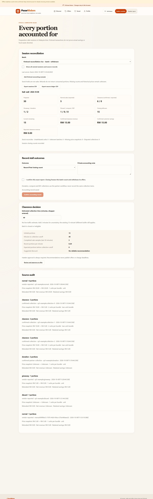

# CP5 — clearance decisions and stock accounting

8 October 2026. **Complete locally.** Closed requirements: `C08-11`, `C08-12`, `C13-01`, `C13-02`. Consolidated totals: **114/151 checked, 37 open**. CP5 has no remaining local jobs; CP6 is next. [Completion plan](COMPLETION_IMPLEMENTATION_PLAN.md). Deployment remains held.

## Delivered behaviour

The hawker `/hawker/accounting` page works in fictional demo and guarded connected modes. It reports sessions grouped by stall and Malaysia date of original preparation, rather than inferring actual market visits. Prepared quantities, transferred stock, reported normal sales, confirmed/reported clearance, giveaway, donation, discard, compost/BSF, current remaining and immutable final closing leftovers are separate. Holds are not consumed stock. Unknown original counts and missing historical movements/prices remain explicit; no legacy sales are invented. Closing rejects active holds, withdraws batch/offers and prevents later stock mutation or restoration.

Private SQL source movements capture collections, direct sales and surplus routes once, with shared reservation locks, transactional stock changes and exact retry fingerprints. Demo adapters capture the same existing workflows under a shared browser lock. Refunds reduce money without restoring consumed portions. Unit/bundle menu and offer prices are captured at sale time and retained after price edits. Savings use original retained value less net revenue; partial refunds prorate retained original value with integer-sen arithmetic. Free collections retain full original value as savings, while disputed or missing-price savings are excluded explicitly. Reported normal-sale revenue does not become confirmed clearance revenue. CSV exports include all owned sessions/source records, with formula escaping.

Recommendations use reconciled unheld portions, at least three non-refunded/non-disputed completed clearance records spanning five minutes in the last 30 minutes, and the earlier batch/market collection cutoff. Sparse/unreconciled histories, closed/expired batches and unknown/infeasible ETA suppress numeric discounts. Shopper-entered ETA is labelled, with two-minute uncertainty and the existing 15-minute fulfilment buffer. Unknown ETA produces no numeric collection forecast. Reliable surplus can suggest 25% or 50%, as an operational heuristic, without changing deadlines or publishing an offer. Hawker approval and actual reservation/collection checks remain required. Reservation holds still have their separate ten-minute maximum; this recommendation is not a booking promise. No live traffic provider, LLM eligibility decision or scientific forecast claim was added.

## Phase-end verification

The phase was built before the gate. Repairs were followed by affected checks only; passing unrelated suites were not repeatedly run.

| Check | Actual result |
| --- | --- |
| Selected frontend domain suites | **118 distinct tests passed** across accounting, shared vectors, commerce, exports, vendor, freshness and partner files; final affected retry: 53 passed |
| Selected backend domain suites | **36 distinct tests passed**: 16 CP5 unit/vector, 12 commerce and 8 connected CP5 cases |
| `python scripts/cp5_gate.py` | Reproducible combined backend gate; actual successful connected groups were run after migration application and surplus/no-show additions |
| Final ESLint, TypeScript, Vite build and Ruff | Pass |
| `node scripts/check-web-secrets.cjs` | Pass after final build |
| API/browser contracts | Regenerated with accounting routes |
| Targeted SQL permissions and migrations | Pass: 31 migrations, three private tables with RLS/no browser privileges, anonymous RPC denial and ownership checks |
| Connected fixture cleanup | Existing 33 stalls / 96 foods retained |
| Browser | Fictional session, normal-sale entry, final closing count, unknown/feasible/excessive ETA, source audit and actual CSV downloads verified |
| Export comparison | Eight example source movements total 15 consumed portions; 30 prepared = 15 consumed + 15 closing leftovers; three clearance collections total 1500 sen revenue and 1500 sen savings in both exports |

Commands for future phase verification:

```powershell
npm run test -w @pasarmalam/web -- src/accounting/model.test.ts src/accounting/vectors.test.ts src/commerce/model.test.ts src/commerce/exports.test.ts src/vendor/model.test.ts src/freshness/engine.test.ts src/partners/model.test.ts
uv run --project apps/api python scripts/cp5_gate.py
npm run lint
npm run build
node scripts/check-web-secrets.cjs
```

Eight connected cases covered owned/private reports, unknown legacy counts, idempotent commands and closing; BOGO confirmation then menu edit/partial refund and cancellation; free collection and cancellation; a concurrent 18-portion direct sale versus four-portion reservation against 20 stock; donation, compost and BSF assignment/acceptance/scheduled collection; and expired no-show holds without consumption. Repeated collections did not duplicate source movements. Existing CP4 policy gates remained active.

Migration: `20261008110113_cp5_stock_accounting.sql`. It was applied additively, preserving prior checksums. An early connected attempt occurred before successful migration application and failed; it is not counted as passing evidence. Compilation/readback and the subsequent application succeeded, followed by all affected connected cases. The earlier transient apply failure's cause was not established. Supabase's security-advisor connector denied project access; targeted SQL checks passed, but no full advisor report is claimed. Function permissions follow [Supabase function guidance](https://supabase.com/docs/guides/database/functions).

React review covered lazy routing, labelled fields, bounded current-state refresh, stale/offline suppression, pending-command input locks, immutable retries, query invalidation and responsive metrics. Existing bundle-size/Zod annotation warnings remain non-blocking. During local rebuilds the PWA required refresh/update; final online routes worked. Offline reload readiness remains unconfirmed in this browser, so no offline device acceptance is claimed.

## Browser and export evidence

Local frontend `127.0.0.1:5174` and API `127.0.0.1:8010` continue running. “Add fictional accounting example” creates a separate fictional stall/batch, preserving the previous catalog. The captured example initially had 30 prepared, 4 reported normal sales, 6 confirmed clearance, 1 giveaway, 2 donation, 1 discard and 16 remaining. Entered ETA five minutes produced a 25% suggestion; ETA 60 minutes suppressed it. A normal sale reduced remaining to 15; final closing retained 15 and blocked clearance. Example collections are synthetic histories; real adapter collection behaviour was verified separately in connected disposable tests.



[Open session and recommendation](screenshots/cp5-open-session.png). Actual browser exports: [session CSV](cp5-session-accounting.csv) and [source ledger CSV](cp5-source-ledger.csv). These include other fictional legacy sessions with explicit gaps; the documented example is `cp5-fictional-stall` / `cp5-fictional-rice-batch`. No private notes or actor credentials are exported.

## Remaining boundaries

No new key or paid service is needed. CP4 qualified food-policy approval and the reviewed cumulative exposure algorithm remain pending. Counts are reported or transaction-confirmed portions, not independently weighed food; CP6 weight metrics and CP7 real pilot evidence remain open. No real customer savings, actual waste diverted, expert food-safety approval, external partner activation or deployment is claimed.
