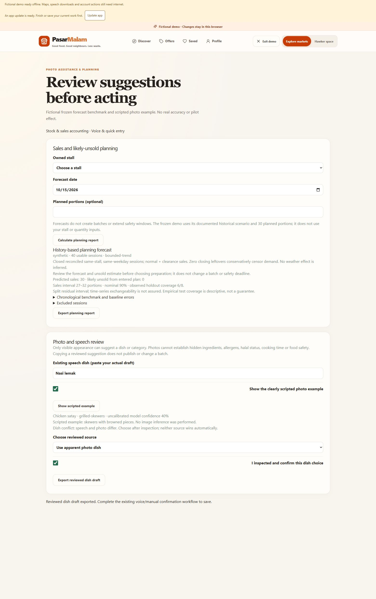

# CP8 — local photo assistance and forecasting

8 October 2026. Local implementation and focused gate complete; **real-history forecast acceptance remains pending**. Deployment held. Three local requirements closed: C05-11, C05-12 and C12-06. Four requirements remain open: C12-01, C12-04, C12-05 and C14-11. Overall: **124 checked / 27 open**.

## Implemented

- `/demo/hawker/planning` has a labelled frozen fictional forecast and scripted photo scenario. `/sandbox/hawker/planning` uses authenticated, owner-scoped history and consented image inference. Accounting links to planning. No planning request creates a batch or changes a deadline.
- Verified hawkers can request apparent dish/category suggestions. JPEG/PNG/WebP is bounded to 5 MB, decoded, oriented, stripped of metadata and resized by the existing Pillow normaliser. No raw image is stored by the app. Provider retention is separate from app storage; do not upload personal/private text.
- Image consent, server-only credentials, one concurrent request, ten requests per actor/hour, 400 output tokens, 40-second timeout and no automatic retries. The actor counter is process-local, resets on API restart and is not a distributed production limiter.
- Existing Morpheus credits are explicitly authorised by the owner. `CP8_ALLOW_PAID_CREDITS=true` is private; the example defaults false. The read-only balance check validates available credit. No billing settings, subscriptions or top-ups were changed. Tokens bound the request size, not its monetary price.
- Image inference defaults to `gemma-4-31b`, independently of the existing `qwen35-9b` text model. Both appear in the [documented vision models](https://apidocs.mor.org/documentation/guides/vision). The actual catalogue returned 200; provider health reported Gemma as its fallback. Two Qwen image attempts returned 503 `model_unavailable`; Gemma produced a fenced JSON response, one attempt timed out, and the corrected contract succeeded. Successful retained response: **395 input / 85 output / 480 total tokens**. This is one illustration smoke check, not measured photo accuracy or a verified bill.
- A single JSON fence is accepted; arbitrary trailing prose is rejected. Suggestions retain uncalibrated confidence and require inspection. Free-form provider evidence is replaced with constrained appearance descriptions: the actual response guessed a sauce ingredient, which cannot be verified visually. Hidden ingredients/allergens, halal status, ethnicity, cooking time and safety are not accepted as evidence.
- Paste the dish from the existing speech draft, inspect the photo suggestion, resolve any dish disagreement and confirm the source. Export is a reviewed dish draft only; use the existing voice/manual confirmation workflow to save. This is a deterministic comparison of the shared dish field, not automatic multimodal publishing.
- Forecasts read the existing CP5 accounting RPC under the owner's token. Exclude incomplete, unreconciled, unknown, future/target-day, different-weekday and zero-leftover demand-censored sessions; reject duplicate historical dates. Require at least 30 usable same-stall, same-weekday sessions. Reported figures retain their ledger provenance; reconciliation does not prove real demand.
- Below the threshold, show the latest reconciled observation when present and request manual small-first-batch planning; absent history produces no precise quantity, interval or benchmark.
- Fixed historical mean/median and bounded trend train on the earliest partition. Validation selects candidates; separate calibration residuals form a nominal 90% interval. Holdout reports MAE and coverage and is used only for the disclosed release decision: show the preselected baseline if the trend does not beat it. Do not describe that release decision as an entirely unused holdout. Time-series coverage is descriptive; exchangeability is not assured.

## Gate and evidence

Phase-end build first, focused checks afterwards; affected retries only after provider-contract repairs.

- **22 distinct backend cases passed**: 21 unit cases and one guarded connected ownership/consent journey. Commands: `uv run --project apps/api python scripts/cp8_gate.py`, then affected provider tests only. Fixtures clean up their own new stall/menu rows. No migrations were added; existing total remains 34; cumulative connected cases 71.
- **Four frontend model cases passed**: conflict comparison, mandatory confirmation, explicit source choice and unknown/manual fallback. Web lint, TypeScript/production build and backend Ruff passed. Existing bundle-size and Starlette deprecation warnings remain.
- Contract export/check and repository/frontend credential scans passed. Local API restarted at port 8010; web preview remains 5174.
- Browser: frozen forecast, displayed average/median/trend errors, Nasi lemak versus Chicken satay disagreement, explicit photo choice, checked confirmation and actual `reviewed-dish-draft.json` download. It contained dish/source/confirmed only; no safety/publishing fields.
- [Vision smoke response](cp8-vision-smoke.json), [synthetic input](../contracts/cp8-forecast-fixture.json), [frozen report](../apps/web/public/planning-demo.json), [collection/benchmark guide](CP8_FORECAST_GUIDE.md).

The synthetic report has 40 usable sessions and one excluded target-day poison row; partitions 16 train / 6 validation / 10 calibration / 8 holdout. Holdout MAE: average 7, median 7, bounded trend 1.0147 portions. Forecast 30; planned 30; likely unsold 0; interval 27–32. **Observed coverage is 6/8 (75%), below nominal 90%.** These numbers test implementation, not real hawker performance.

## Remaining acceptance

- [ ] C12-01: collect enough consented, reconciled actual history and review sales/demand censoring and likely-unsold performance.
- [ ] C12-04: assess calibration and empirical coverage on actual held-out history; do not advertise nominal coverage as achieved.
- [ ] C12-05: run the frozen real historical-average/median comparison and retain all errors, including a worse candidate.
- [ ] C14-11: produce a reviewed real forecasting benchmark. Use a later untouched audit period after any iteration on the original holdout.

No new API key is needed. Real sessions and consent/provenance are needed; credits cannot substitute for that evidence. Photo capability works locally but its accuracy across real food/phone photos remains unmeasured. CP7 participant/device work stays pending.
