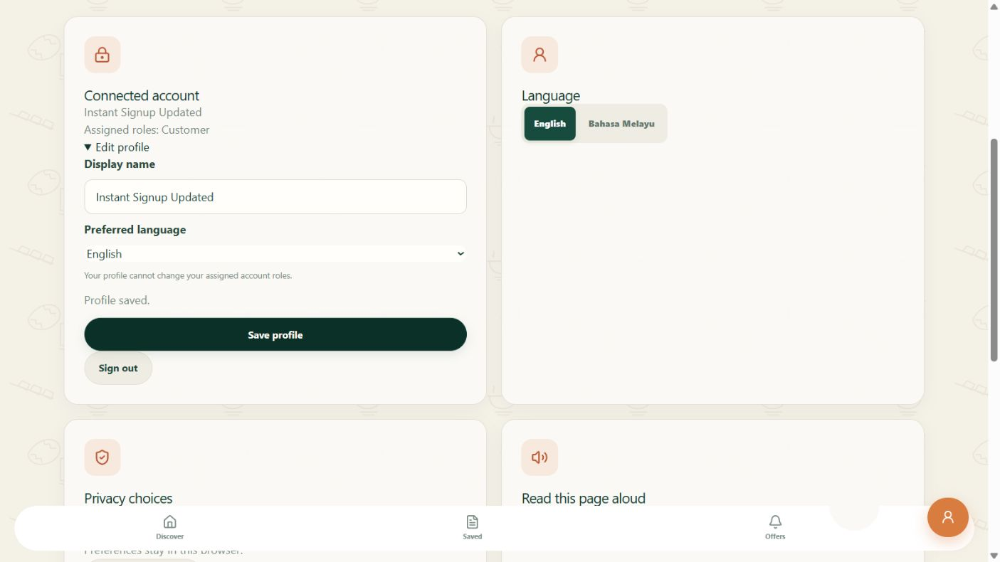
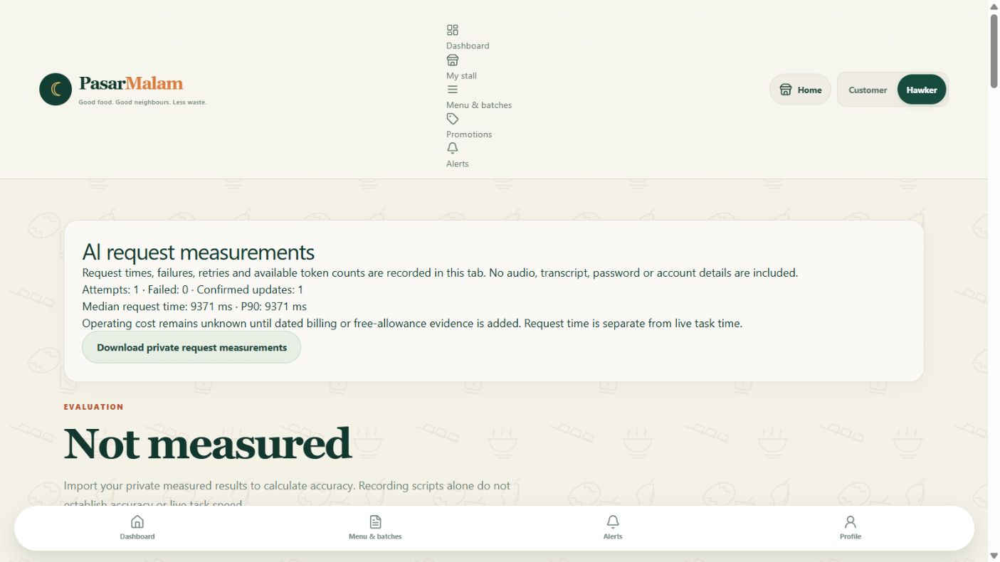

# Local feature completion — 9 October 2026

Completed the available engineering and evidence work. The checklist now has **126/151 checked locally and 25 open**. This count includes labelled simulations and is not production certification.

## Instant signup and profile editing

The owner selected instant public signup. Supabase allows new accounts and has email confirmation OFF. A real public Auth signup returned an immediate session without an invitation/email. The automatically populated confirmation field does **not** verify email ownership in this mode.

Added connected display-name and preferred-language editing through the existing own-profile database operation. Protected identity, roles and verification cannot be edited. A two-second JWT clock tolerance fixes occasional immediate rejection when the provider clock is a fraction of a second ahead; materially future and expired sessions remain rejected.

The generated fictional customer signed in through the browser, received customer only despite forged privileged metadata, edited its name/language and signed out. Fresh login and database checks confirmed persistence. Vendor/admin endpoints returned 403; injected profile role fields returned 422. Only this test identity was deleted and its private credential file removed. The owner's password/account was untouched.

This closes **C01-03 in the controlled local scope**. Owner personal password entry, recovery-email delivery and privacy approval before real participants remain separate release actions. [Account guide](STEP1_PUBLIC_SIGNUP_SETUP.md).

## Automatic request measurements

Added tab-scoped AI request timing, failures/cancellations/retries, available provider token counts and links to confirmed saves. Private JSON exports contain no audio, transcript, account identifier, password or API key. Unknown usage/cost stays unknown; unavailable storage and truncation are flagged.

A fictional text-only Morpheus menu update was extracted, read back, confirmed and saved. Actual browser export: **one attempt, zero failures, one confirmed update, 9,370.8 ms browser elapsed, 2,282 input tokens, 204 output tokens**. Cost per success is null. This is one technical observation, not a latency benchmark, live microphone test or participant timing. Acceptance used the configured `127.0.0.1` origin; the alternate `localhost` origin did not expose provider readiness.

This improves collection for **C14-08/C15-06**, which remain open pending participant and dated billing/free-allowance evidence. [Measurement guide](AI_REQUEST_MEASUREMENT_GUIDE.md).

## Competition evidence

Read all four pages of the supplied competition PDF. [Verified rules](COMPETITION_RULES_VERIFIED.md) and [structured facts](../contracts/competition-rules.json) retain source provenance.

[TRL evidence](TRL4_EVIDENCE.md) documents integrated critical components and controlled validation supporting a TRL 4 engineering inference for the core software prototype. This closes **C15-10**, a documentation requirement. The PDF does not define an assessment method; this is not an organiser-awarded level or real-market/food-policy approval. Actual eligibility, supervisor, prior-version declaration, student video and intended-device rehearsal remain open.

## Validation and remaining inputs

- **70 distinct selected frontend cases passed** across metrics/transport, voice workflows/timing/evaluation and registration.
- **100 distinct selected API cases passed** across voice/provider usage/errors, profile/onboarding and authentication. Affected failures were repaired and rerun; totals are distinct cases across this batch, not a single full-suite run.
- Frontend lint, TypeScript and production build passed after the frontend batch. Changed Python files passed Ruff after formatting/import repair. Existing bundle-size/Zod and test deprecation warnings remain.
- Browser proof covers connected sign-in/profile edit and actual extraction → confirmation → metrics export. Final contract/credential/document checks are recorded in the phase log.

The remaining 25 requirements need fresh independent voice recordings and participant measurements, qualified food rules (then exposure implementation), real reconciled sales history, student/team/video deliverables, real partner agreements/data or native build/device access. [All open requirements/actions](PARTIAL_AND_PENDING_JOBS.md) and [one hands-on human guide](HUMAN_FEATURE_COMPLETION_GUIDE.md) are updated. Phone/PWA/offline/push acceptance and recovery delivery remain additional release checks. Deployment stays on hold.
