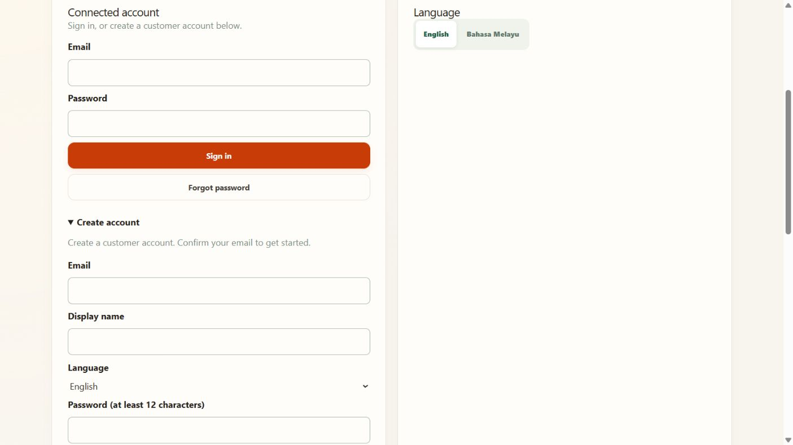

# Step 1 — Public signup and easy sign-in

Updated: **9 October 2026**. This replaces invitation-only setup.

## Ready

- [x] Public signup enabled in Supabase and the local app.
- [x] Confirmed customers can create a profile without an invitation.
- [x] New profiles are created automatically after successful authentication.
- [x] Email links return to the actual app, instead of localhost port 3000.
- [x] Create account, Sign in and Forgot password controls are available in English/Bahasa Melayu.
- [x] New customers cannot choose hawker/admin privileges.
- [x] Focused tests (10 frontend; 21 backend/connected) and browser sign-in passed for existing and newly provisioned fictional customers. The temporary new customer was removed after testing.
- [ ] Finish the email setup choice: custom SMTP with confirmation, or explicitly select instant demo signup.
- [ ] Owner sets their own password and completes the actual sign-in journey.

## New account

1. On this computer, open [PasarMalam Profile](http://127.0.0.1:5174/sandbox/profile).
2. Choose **Create account**.
3. Enter your email, a display name, language and a password of at least 12 characters. Use a fictional display name in this test environment.
4. Acknowledge the displayed notice yourself, then submit **Create account**.
5. With email confirmation enabled, open the email and **click Confirm email**. It returns to the app; you do not need to copy a token or choose a link type. If it opens another browser, use that browser on this same computer.
6. Your customer profile is created automatically. Later, use **Sign in** with that email/password.

## Your previously invited email

It already has a confirmed Auth account. Creating another account with the same email will not replace its password.

1. Open [Profile](http://127.0.0.1:5174/sandbox/profile).
2. If you know the password, enter it and **Sign in**.
3. Otherwise enter your email in the sign-in section, choose **Forgot password**, and open the newest reset email.
4. Click its button. New reset emails return to **Set your password** in the app.
5. Enter your own new password twice and click **Save password**.
6. Sign in using that email and new password. The app creates a missing customer profile automatically.

Older emails still contain the old port-3000 address. Request a new email, or use the optional **Already have an email link?** section for an unused original link. Do not send account links or passwords in chat.

## Email setup still needed for public users

The current project uses Supabase's default sender. It delivers only to project-team email addresses and is currently limited to two messages per hour. These limits are documented by [Supabase](https://supabase.com/docs/guides/auth/auth-smtp).

Select one of the pending choices:

- **Keep confirmation:** supply an SMTP sender account through a private setup channel. Needed inputs are host, port, sender address/name and credentials. Do not put credentials in this file or GitHub. The developer can finish the connection; password/credential entry in the dashboard is yours.
- **Instant demo signup:** explicitly choose this option. New demo accounts can then sign up and sign in without a confirmation email. Their email ownership will not be verified. This does not fix password-reset email delivery and is not a production email setup.

Confirmation stays ON until you choose. If an email request is rate-limited, wait before retrying. Do not repeatedly send reset requests.

The feature remains partial until the owner's password/login journey and selected email setup are complete. Public hosting is a separate step; these links work while the local app runs on your computer.

