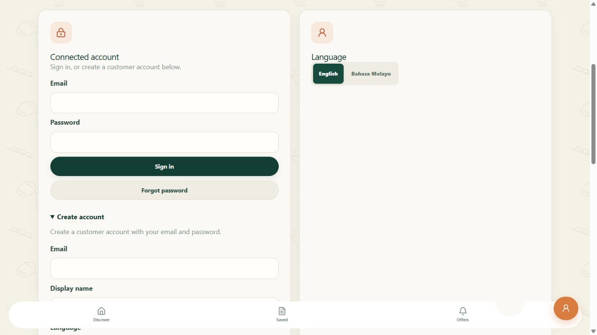

# Step 1 — Instant public signup and easy sign-in

Updated **9 October 2026**. The owner selected **instant public signup for this demo**, replacing invitations and confirmation-email signup.

## Ready

- [x] Public signup is ON; Confirm email is OFF, saved in Supabase.
- [x] New customers receive an immediate session without an invitation or confirmation email.
- [x] Missing customer profiles are created automatically; display name/language are editable.
- [x] New accounts receive customer only; mode changes and metadata cannot grant hawker/admin access.
- [x] Browser signup/sign-in/profile and protected API checks passed using a generated fictional identity, subsequently removed.
- [x] Immediate sign-in tolerates a two-second clock difference while retaining signature, issuer, audience and protected role checks.

## Create a new account

1. On this computer, open [PasarMalam Profile](http://127.0.0.1:5174/sandbox/profile).
2. Choose **Create account**.
3. Enter your own email, a fictional display name, preferred language and a password of at least 12 characters. Enter the password yourself; do not send it in chat.
4. Read and acknowledge the displayed notice, then submit **Create account**.
5. Use the account immediately. No confirmation email is required. Email ownership is unverified in this demo mode.
6. Choose **Edit profile details**, change your name/language and **Save profile**.
7. Sign out and sign in again using that email/password.

Customer accounts stay customers. Connected stall management needs an account assigned hawker privileges through the protected organiser process. The fictional demo workspace is available separately.

## Your existing email account

Your previously invited email already has an Auth account. Creating another account with the same email does not replace its password.

1. Open [Profile](http://127.0.0.1:5174/sandbox/profile).
2. If you know your password, use **Sign in**.
3. Otherwise enter your email, choose **Forgot password**, open the newest reset email and set your own new password in the app.
4. Sign in, edit your profile, sign out and sign in again.

The owner must complete their own password entry. No password was set/changed on their behalf. Old emails may use port 3000; request a fresh reset rather than sharing tokens/links in chat.

## Password-recovery email

Instant signup no longer needs a sender. **Password recovery still does.** Supabase's default sender restricts recipients to project-team addresses and has a low send rate; see [Supabase SMTP documentation](https://supabase.com/docs/guides/auth/auth-smtp). A custom sender is needed before claiming reliable recovery for arbitrary public users. Keep sender credentials private.

Owner password acceptance, recovery delivery and privacy approval before real participant collection are separate release actions. Local links work while this computer runs the app; public hosting remains deferred.

