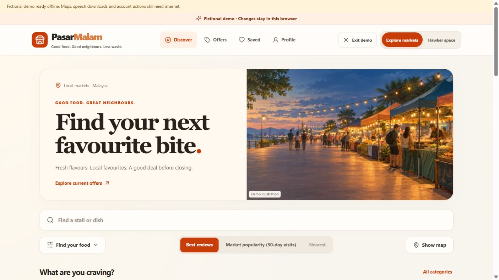
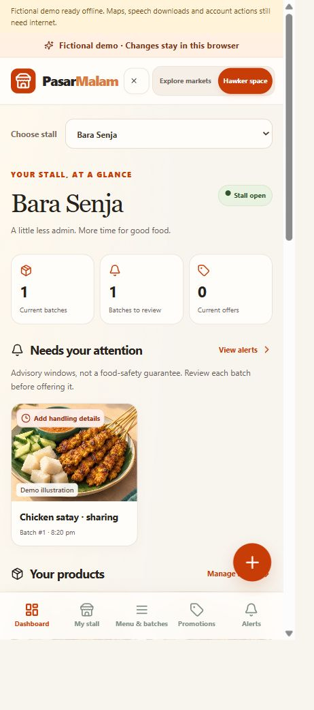

# UI and UX refresh — 8 October 2026

The local app now uses the supplied customer/hawker reference as visual direction: warm cream surfaces, orange actions, charcoal text, large serif headings, rounded image cards and simpler navigation. Existing domain workflows, permissions and demo separation remain in place. No deployment was performed.

## Completed work

- [x] Customer discovery: photo hero, prominent search, expandable filters, segmented sorting, category tiles, market covers and illustrated matching food cards.
- [x] Market/stall detail and customer offers: consistent cards, representative artwork and clear menu prices/statuses.
- [x] Hawker overview: stall selection at the top, selected-stall batch/review/offer counts, actionable batch reminders, products and current clearance listings.
- [x] Hawker entry: voice-first quick actions, Add food and New batch, plus a mobile floating action menu. Opening a form scrolls it into view; existing confirmation and validation remain in control.
- [x] Shared presentation: cream/orange theme, accessible focus states, responsive spacing and navigation, and reduced-motion support.
- [x] Integrate all 12 originals from `IMAGE/`; preserve originals, remove output metadata and produce 24 responsive WebP files.
- [x] Label representative art as **Demo illustration**; provide alt text and described placeholders for unmatched subjects or failed image requests. Fictional art is limited to demo/sandbox modes.
- [x] Preserve original batch-photo/audit and private complaint-evidence boundaries. Representative food artwork does not become evidence of a newly cooked batch or a safety/halal certification.
- [x] Update presentation library, demo entry copy, README, implementation plan and current user-action checklists.

## Images and tools

Implementation uses the existing React/TypeScript/Vite app, React Router, TanStack Query, i18next, Lucide icons, native form controls and CSS. No paid UI service or remote image generator was added. The asset preparation command uses the existing Python/Pillow dependency:

```powershell
uv run --project apps/api python scripts/prepare_demo_images.py
```

The 12 supplied PNG originals total **29,297,792 bytes**. Their 24 WebP variants total **1,872,656 bytes**, about **94% smaller in aggregate**. Each original has a 960-pixel maximum-edge version and a 480-pixel version. Images use responsive sources, lazy loading, an eager hero and failure placeholders.

Actual outputs live in `apps/web/public/demo/images/`. [Supplied-image provenance](supplied-image-provenance.json) records source filenames, hashes, optimisation method and output sizes. Generator/model and public-use rights were not supplied and are explicitly marked unknown/pending. The [legacy manifest](asset-manifest.json) and presentation JSON retain 100 logical slot descriptions; they are not a claim that 100 image files were delivered. Curated subject mappings connect matching slots to the 12 supplied originals. Unmatched stalls/dishes, people, partner logos, advertisements and evidence remain described placeholders or icons.

## Completed verification

The refresh was built as one batch before the focused gate. An initial TypeScript error was repaired; the successful gate passed **92 tests in six files**: artwork boundaries, discovery, vendor model, freshness, presentation and service-worker behaviour. Four artwork tests are new. ESLint, TypeScript, production build, the configured frontend credential scan and Ruff for the asset script passed. Final browser-driven styling/copy/form refinements passed lint, type checking, build and credential scanning; the 92 domain tests were not repeatedly rerun.

Gate commands from the repository root; repeat only after a completed relevant build batch or an affected failure:

```powershell
npm run lint
npm run typecheck
npm run build
npm run test --workspace @pasarmalam/web -- src/components/demo-images.test.ts src/discovery/engine.test.ts src/vendor/model.test.ts src/freshness/engine.test.ts src/presentation/model.test.ts src/app/service-worker.test.ts
uv run --project apps/api ruff check scripts/prepare_demo_images.py
node scripts/check-web-secrets.cjs
```

Browser checks against the production preview confirmed:

- Category and search filtering, dietary-filter exclusion and reset still work.
- Switching Bara Senja to Dapur Embun updates the selected heading, open/closed status and matching products/artwork together.
- The mobile floating New batch action closes its menu and opens the existing batch form at the top of the visible scroll area. The form was closed without saving.
- No broken rendered images or horizontal overflow were observed. Desktop viewport/document widths were 1422/1405 pixels; narrow preview widths were 434/417 pixels. Scrollbars explain the smaller document widths. These are browser previews, not measurements from a physical phone.
- Applying the app update resulted in the controlling worker's **Fictional demo ready offline** acknowledgement. A successful network-disconnected reload was not tested in this refresh and remains open.

The production build still reports the existing large main-chunk warning and dependency annotation warnings. The speech model/WASM payload still needs the separately tracked target-phone memory check. Backend/SQL behaviour was not changed or broadly retested by this presentation update.

## Evidence





## Remaining actions

- [ ] Supply generator/model/date and confirm public-use rights for the 12 originals before future public release. No additional artwork is required for local use.
- [ ] Complete physical-phone accessibility, BM/English, microphone/memory, installation and actual offline reload acceptance.
- [ ] Complete actual displayed push receipt and consenting human voice recordings/timing, as already tracked in [your action checklist](YOUR_ACTION_CHECKLIST.md).

Deployment remains the separate final phase, on hold. Food advisories and business integrations remain labelled demonstration policies/simulations.
